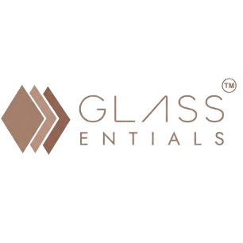
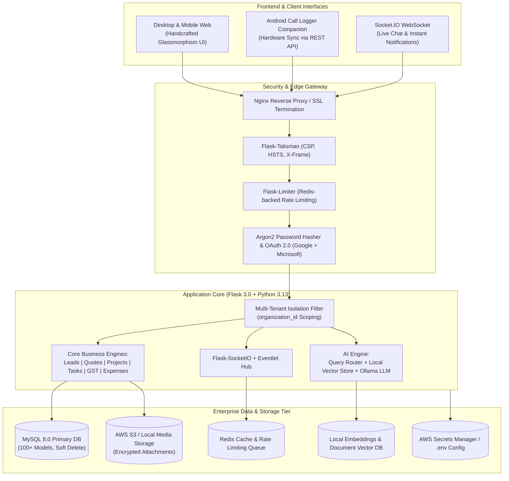

# <p align="center"><br>💎 GlassEntials Enterprise CRM & ERP</p>

<p align="center">
  <strong>The Next-Generation, Multi-Tenant Cloud ERP & Intelligent CRM Suite Built for Glass & Mirror Enterprises and Modern Fast-Growing Businesses.</strong>
</p>

<p align="center">
  <a href="#"></a>
  <a href="#"></a>
  <a href="#"></a>
  <a href="#"></a>
  <a href="#"></a>
  <a href="#"></a>
  <a href="#"></a>
  <a href="#"></a>
</p>

---

## 📑 Table of Contents

- [✨ Executive Overview](#-executive-overview)
- [🏢 Enterprise Architectural Matrix](#-enterprise-architectural-matrix)
- [🔥 Comprehensive Core Modules](#-comprehensive-core-modules)
  - [1. 🤖 AI-Powered Copilot & Vector RAG Assistant](#1--ai-powered-copilot--vector-rag-assistant)
  - [2. 🏢 Multi-Tenant SaaS Engine & Subscription Billing](#2--multi-tenant-saas-engine--subscription-billing)
  - [3. 🎯 Lead & Sales Funnel Management](#3--lead--sales-funnel-management)
  - [4. 🤝 Customer & Client 360° Management](#4--customer--client-360-management)
  - [5. 🏬 B2B Organizational Clients & Multi-City Branches](#5--b2b-organizational-clients--multi-city-branches)
  - [6. 📜 Enterprise Quotation & Proposal Studio](#6--enterprise-quotation--proposal-studio)
  - [7. 📦 Products, Catalog & Multi-Tier Pricing](#7--products-catalog--multi-tier-pricing)
  - [8. 🏗️ Project Management & Engineering Tracking](#8--project-management--engineering-tracking)
  - [9. 💰 Accounts, Billing, Payments & GST Engine](#9--accounts-billing-payments--gst-engine)
  - [10. 🏷️ Corporate Expense & Reimbursement Workflow](#10--corporate-expense--reimbursement-workflow)
  - [11. 🚚 Vendor & Procurement Supply Chain](#11--vendor--procurement-supply-chain)
  - [12. 📞 Android Hardware Call Logger & Telephony API](#12--android-hardware-call-logger--telephony-api)
  - [13. 💬 Real-Time Employee Chat & Collaboration (Socket.IO)](#13--real-time-employee-chat--collaboration-socketio)
  - [14. 👑 Super Admin Fleet & Governance Control Plane](#14--super-admin-fleet--governance-control-plane)
  - [15. 🗄️ Enterprise Trash, Soft Deletion & Audit Trail](#15--enterprise-trash-soft-deletion--audit-trail)
- [🛡️ Enterprise Security, Auth & Data Isolation](#️-enterprise-security-auth--data-isolation)
- [🛠️ Technology Stack & Engine Specs](#️-technology-stack--engine-specs)
- [🚀 Quickstart & Production Deployment](#-quickstart--production-deployment)
  - [Local Development Setup](#local-development-setup)
  - [Production Cloud Deployment](#production-cloud-deployment)
- [⚙️ Environment Configuration (.env Reference)](#️-environment-configuration-env-reference)
- [📂 Project Topology & Directory Architecture](#-project-topology--directory-architecture)
- [🗺️ Future Development Roadmap](#️-future-development-roadmap)
- [📄 License & Authorship](#-license--authorship)

---

## ✨ Executive Overview

**GlassEntials CRM & ERP** is an industry-grade, end-to-end Enterprise Resource Planning and Customer Relationship Management platform. Originally engineered for the complex, high-stakes manufacturing, architectural fabrication, and distribution workflows of the **Glass and Mirror Industry**, it has evolved into a hyper-scalable, multi-tenant SaaS framework suited for any modern project-driven business.

Combining a **custom handcrafted Glassmorphic Luxury UI (Obsidian & Metallic Gold)** with strict enterprise isolation, local vector AI copilots, Android telephonic monitoring, automated GST compliance, and real-time collaboration, GlassEntials bridges the gap between shop-floor execution and executive balance sheets.

```
+--------------------------------------------------------------------------------------------------+
|                                    GLASSENTIALS ERP / CRM SUITE                                 |
+--------------------------------------------------------------------------------------------------+
|  [ Multi-Tenant SaaS Engine ]  --  Organizations, Subscriptions, Razorpay Webhooks, Seat Limits  |
+--------------------------------------------------------------------------------------------------+
|  [ AI RAG Copilot ]            --  Local Embeddings, Vector Search, Ollama LLM, Natural Queries   |
+--------------------------------------------------------------------------------------------------+
|  [ Sales & Operations ]        --  Leads, B2B Clients, Contacts, Dynamic Quotes, Projects, Tasks |
+--------------------------------------------------------------------------------------------------+
|  [ Financials & Supply Chain ] --  Invoices, Payments, Indian GST, Vendor Hub, Expense Approval  |
+--------------------------------------------------------------------------------------------------+
|  [ Telephony & Comms ]         --  Android Device Call Logger API, Real-Time Socket.IO Chat      |
+--------------------------------------------------------------------------------------------------+
|  [ Control & Governance ]      --  Super Admin Dashboard, RBAC, Soft Deletion, Org Audit Vault  |
+--------------------------------------------------------------------------------------------------+
```

---

## 🏢 Enterprise Architectural Matrix



---

## 🔥 Comprehensive Core Modules

### 1. 🤖 AI-Powered Copilot & Vector RAG Assistant
GlassEntials features an intelligent, air-gapped or cloud-connected **AI Assistant** capable of conversing directly with your business database using Retrieval-Augmented Generation (RAG).
- **Zero Cloud Leakage**: Native support for **local LLMs via Ollama** (e.g., `mistral`, `llama3`, `qwen`) — your confidential corporate records, client quotes, and financial ledgers never leave your infrastructure.
- **Smart Query Routing**: The NLP router determines whether a query is a CRM database filter (*"Show me leads created by Ratandeep in Mumbai"*), a document semantic search (*"What are the payment terms in contract #42?"*), or general business assistance.
- **Context Builder & Local Embeddings**: Built with `sentence-transformers` and chunked document indexing (PDF, DOCX, TXT) with mathematical vector retrieval.
- **Role-Aware Scoping**: The AI strictly respects tenant boundaries and user RBAC; employees can only discover data their credentials permit.

### 2. 🏢 Multi-Tenant SaaS Engine & Subscription Billing
A complete Turnkey Software-as-a-Service architecture enabling independent enterprise instances within a single unified deployment.
- **Strict Data Isolation**: Every database table enforces foreign key relationships to an `Organization`. Dynamic query filters guarantee zero data leakage between competing companies.
- **Tiered SaaS Plans**: Manage custom subscription tiers with hard and soft limits (User count, Project quotas, Storage bandwidth, Feature flags).
- **Razorpay Payment Gateway**: Integrated checkout, recurring subscription cycles, automated invoice generation, and signature-verified webhook processing.
- **Instant Org Provisioning**: Automated onboarding wizard with company domain verification, initial admin account setup, and seed configurations.

### 3. 🎯 Lead & Sales Funnel Management
Accelerate lead velocity from first inquiry to closed contract.
- **Full Sales Lifecycle**: Track inquiries through *New*, *Contacted*, *Qualified*, *Proposal Sent*, *Negotiation*, and *Won/Lost*.
- **Direct 1-Click Conversion**: Convert qualified leads into active Customers and initiate Projects with preserved conversation and quote history.
- **Omnichannel Source Attribution**: Track leads originating from Website, Google Ads, Referrals, Social Media, Showroom Walk-ins, or Field Sales.
- **Staff Assignment & Auto-Balancing**: Assign leads to sales agents, set follow-up deadlines, and track closing conversion ratios per representative.
- **Live Search & Multi-Filter**: Real-time debounce search across names, phone numbers, emails, cities, and statuses without full-page reloads.

### 4. 🤝 Customer & Client 360° Management
A holistic, unified view of every commercial customer relationship.
- **360-Degree Profile View**: Complete timeline history displaying linked quotes, active projects, uploaded architectural blueprints, payment history, and communication logs.
- **GSTIN Auto-Validation**: Integrated validation ensuring client Tax Identification Numbers adhere to statutory formats.
- **Document Management**: Secure file vault for client agreements, site photos, tax exemption certificates, and signed acceptance slips.
- **Bulk Import & Export**: High-performance multi-column CSV/Excel import parser with error reporting, plus 1-click PDF/Excel export.

### 5. 🏬 B2B Organizational Clients & Multi-City Branches
Engineered specifically for corporate B2B relationships where clients are large developers, architectural firms, or hotel chains.
- **Parent-Child Hierarchy**: Organize enterprise accounts with multiple national offices, branch sites, and regional sub-divisions.
- **Multi-City Coverage Mapping**: Group enterprise operations across metropolitan regions with dedicated points of contact for each city.
- **Stakeholder Directory**: Maintain a roster of key personnel (Procurement Officers, Site Engineers, Billing Managers) with individual roles and direct lines.

### 6. 📜 Enterprise Quotation & Proposal Studio
The crown jewel of GlassEntials — a specialized, high-precision estimation and quotation studio tailored for glass fabrication, hardware, and engineering installations.
- **Formula-Driven Pricing Engine**: Handles glass dimensions (sqft, sqm, running ft), thickness (4mm–19mm), toughening, laminating, frosted finishes, edging, and custom hardware accessories.
- **Dynamic Terms & Conditions**: Modular library of legal clauses, warranty terms, delivery timelines, and transit insurance parameters.
- **Multi-Tier Approvals & Revisions**: Version-controlled quotations (`REV-01`, `REV-02`) with status tracking (*Draft*, *Sent*, *Accepted*, *Declined*, *Expired*).
- **Digital Signatures & Attachments**: Incorporate authorized representative digital signatures, corporate stamps, and technical specification sheets.
- **Pixel-Perfect PDF Generation**: One-click generation of branded, luxury aesthetic PDFs ready for client presentation.

### 7. 📦 Products, Catalog & Multi-Tier Pricing
Comprehensive inventory catalog management built for complex product variants.
- **Multi-Level Categorization**: Organize items across Architectural Glass, Mirrors, Shower Cubicles, Spider Fittings, Railings, and Hardware.
- **Flexible Unit of Measurement (UoM)**: Full native support for Square Feet, Square Meters, Metric Tons, Pieces, Running Meters, and Bundles.
- **HSN / SAC Tax Tagging**: Pre-configured HSN codes for GST calculation and tax invoice compliance.

### 8. 🏗️ Project Management & Engineering Tracking
Bridge sales promises with physical shop-floor and on-site reality.
- **End-to-End Milestones**: Track projects from *Site Measurement*, *CAD Drafting*, *Glass Cutting*, *Toughening*, *Dispatch*, through *On-Site Glazing & Handover*.
- **Assigned Engineering Crews**: Delegate team leads, field technicians, and glazier squads with accountability tracking.
- **Budget vs. Actual Variance**: Monitor quotation revenue against real-world material consumption, labor expenses, and subcontractor fees.
- **Document Repositories**: Store CAD diagrams, measurement sheets, structural engineering certificates, and final snag lists.

### 9. 💰 Accounts, Billing, Payments & GST Engine
Full-spectrum financial clarity and statutory Indian tax compliance.
- **Tax Invoicing & Proforma Invoices**: Generate compliant GST tax invoices linked directly to accepted quotations and milestone deliveries.
- **Dual Payment Tracking**: Log partial installments, advance deposits, retention payments, and payment clearances with sequential numbering (`PAY-XXXXX`).
- **Mode & Instrument Verification**: Track NEFT, RTGS, IMPS, UPI, Cheques, and Cash with clearing dates and bank transaction references.
- **Automated GST Reports (GSTR-1 & GSTR-3B Ready)**: Built-in report generator calculating CGST, SGST, IGST, reverse charges, and state breakdowns exportable to Excel.

### 10. 🏷️ Corporate Expense & Reimbursement Workflow
Keep operating expenditures, site expenses, and travel allowances strictly controlled.
- **Categorized Logging**: Site travel, tooling, client entertainment, logistics, machinery maintenance, and petty cash.
- **Multi-Level Approval Pipeline**: Real-time status progression (*Pending*, *Approved*, *Rejected*, *Reimbursed*) with role restrictions.
- **Receipt & Proof Uploads**: Integrated image/PDF receipt viewer ensuring zero unauthorized payouts.

### 11. 🚚 Vendor & Procurement Supply Chain
Manage raw material suppliers, glass processors, and hardware distributors.
- **Vendor Profiles & Due Diligence**: Store vendor bank details, MSME certificates, GSTIN, and verification statuses.
- **Payment Terms & Schedules**: Enforce credit periods (Net 15, Net 30, Net 60, Advance) and monitor outstanding payables.
- **Vendor Activity Trail**: Log communication histories, rate negotiations, and supply performance metrics.

### 12. 📞 Android Hardware Call Logger & Telephony API
Seamless bridge between executive mobile calls and CRM records.
- **Native Android Sync Companion**: Integrates with an Android companion application that automatically pushes call logs to the cloud.
- **Device Cryptographic Pairing**: Devices pair using secure SHA-256 hashed Bearer tokens with active/inactive status controls.
- **Smart Number Matching**: Automatic normalization of phone numbers (`+91` format) linking incoming/outgoing calls directly to existing Leads and Customers.
- **Call Disposition & Follow-Up Automation**: Record call results (*Connected*, *Busy*, *Wrong Number*, *Interested*) and trigger follow-up tasks on missed calls.

### 13. 💬 Real-Time Employee Chat & Collaboration (Socket.IO)
Eliminate fragmented external messaging apps with a compliant, internal workspace chat.
- **WebSocket Live Delivery**: Powered by `Flask-SocketIO` and `eventlet` for sub-second, bidirectional message delivery.
- **Direct & Group Conversations**: 1-on-1 direct employee messaging and cross-functional team channels.
- **Secure File Sharing**: Share site pictures, PDF proposals, and blueprints directly within the conversation.
- **Tenant Isolation**: Cryptographically verified channel rooms guaranteeing that messages remain strictly within the employee's organization.

### 14. 👑 Super Admin Fleet & Governance Control Plane
A sovereign master control plane (`/admin`) for platform operators and SaaS owners.
- **Isolated Domain / Path**: Decoupled from tenant workflows with specialized authentication.
- **Two-Factor OTP Security**: Email-dispatched 6-digit cryptographic OTP required on every super admin session.
- **Global Fleet Telemetry**: Live metrics across total organizations, MRR (Monthly Recurring Revenue), active subscriptions, and system resource load.
- **Tenant Management**: Provision, suspend, upgrade, or soft-delete tenant organizations, adjust member quotas, and inspect organization-level audit logs.

### 15. 🗄️ Enterprise Trash, Soft Deletion & Audit Trail
Accidental data deletion is mathematically impossible in GlassEntials.
- **Unified Soft-Delete Mechanism**: Database entities utilize an `is_deleted` flag; deleted records vanish from operational views but remain intact in the database.
- **Centralized Trash Station (`/workplace/trash`)**: Search, filter, and 1-click restore erroneously deleted Leads, Customers, Quotations, Invoices, and Tasks.
- **Comprehensive Audit Logs**: Every modification, status transition, creation, and soft-deletion records the exact timestamp, actor user ID, client IP, and diff snapshot.

---

## 🛡️ Enterprise Security, Auth & Data Isolation

GlassEntials is engineered around OWASP top-10 defensive principles:

```
+--------------------------------------------------------------------------------------------------+
|                                    SECURITY ARCHITECTURE OVERVIEW                                |
+--------------------------------------------------------------------------------------------------+
|  [ Authentication ]   Argon2-cffi Password Hashing | Google OAuth 2.0 | Microsoft Azure AD SSO   |
|  [ Rate Limiting ]    Flask-Limiter with Redis Backend (Guards Brute-force & Telephony APIs)     |
|  [ Header Hardening ] Flask-Talisman (Strict CSP, HTTP Strict Transport Security HSTS)           |
|  [ CSRF Defense ]     Flask-WTF Synchronizer Tokens on all POST / PUT / DELETE forms             |
|  [ RBAC Matrix ]      SuperAdmin, Org Owner, Admin, Manager, Sales Rep, Staff, Site Engineer     |
|  [ Cryptography ]     AWS Secrets Manager integration for automated production rotation          |
+--------------------------------------------------------------------------------------------------+
```

- **Argon2 Password Hashing**: Winner of the Password Hashing Competition; delivers high resistance to GPU/ASIC cracking.
- **Enterprise Single Sign-On (SSO)**: Built-in OAuth 2.0 connectors for Google Workspace and Microsoft Entra ID (Azure AD).
- **Session & CSRF Protection**: Every session is protected with `HttpOnly`, `SameSite=Lax`, secure cookie flags, and unique CSRF tokens.
- **Tenant Scoping Decorators**: Controllers utilize the `@tenant_record_id` and `@require_roles` decorators to verify that accessed resource IDs strictly belong to `current_user.organization_id`.

---

## 🛠️ Technology Stack & Engine Specs

| Layer | Technologies & Libraries |
|---|---|
| **Core Runtime** | Python 3.13, Flask 3.0.3, Werkzeug 3.0.3 |
| **Concurrency & WebSockets** | Flask-SocketIO 5.3.6, eventlet 0.33.3, Gunicorn 22.0.0 |
| **Database & ORM** | MySQL 8.0+, SQLAlchemy 2.0.31, Flask-SQLAlchemy 3.1.1, PyMySQL 1.1.0 |
| **Migrations** | Alembic, Flask-Migrate 4.0.7 |
| **Security & Cryptography** | argon2-cffi 23.1.0, Flask-WTF 1.2.1, Flask-Limiter 3.7.0, flask-talisman 1.1.0 |
| **AI & NLP Engine** | Ollama (Mistral / LLaMA3), sentence-transformers 3.3.1, NumPy, PyPDF2 |
| **Data Processing & Exports** | Pandas 2.2.2, openpyxl 3.1.2, XlsxWriter 3.2.0, fpdf2 2.7.9 |
| **Cloud & Payment Gateways** | Boto3 (AWS S3 & Secrets Manager), Redis 5.0.4, Razorpay 1.4.1 |
| **Frontend Framework** | Handcrafted Responsive Glassmorphism CSS, Vanilla ES6+ JavaScript |
| **Production Server** | Nginx Reverse Proxy, Systemd Daemon, Gunicorn WSGI |

---

## 🚀 Quickstart & Production Deployment

### Local Development Setup

#### Prerequisites
- **Python 3.11+** (Python 3.13 recommended)
- **MySQL 8.0+** running locally or on Docker
- **Redis Server** (optional for dev, recommended for rate limiting and Socket.IO)
- **Ollama** (optional, for local AI Copilot capabilities)

#### Step 1: Clone the Repository
```bash
git clone https://github.com/your-username/CRM-GlassEntials.git
cd CRM-GlassEntials
```

#### Step 2: Establish Virtual Environment
```bash
python -m venv venv
# On Windows:
.\venv\Scripts\activate
# On Linux/macOS:
source venv/bin/activate
```

#### Step 3: Install High-Performance Package Suite
```bash
pip install --upgrade pip
pip install -r requirements.txt
```

#### Step 4: Configure Environment Variables
Copy the development template and configure your local database:
```bash
copy .env.example .env   # Windows
# or: cp .env.example .env # Linux/macOS
```

#### Step 5: Database Migration & Schema Creation
```bash
flask db upgrade
```

#### Step 6: Launch the Development Server
```bash
python app.py
```
*The portal will be live at `http://localhost:5000` (or your configured port).*

---

### Production Cloud Deployment

GlassEntials includes pre-configured production manifests for **Ubuntu / Debian Linux**, **Nginx**, **Systemd**, and **Gunicorn**.

#### 1. Systemd Service Configuration
Edit and place `glassentials.service` into `/etc/systemd/system/`:
```ini
[Unit]
Description=GlassEntials Gunicorn & SocketIO Production Daemon
After=network.target mysql.service redis.service

[Service]
User=www-data
Group=www-data
WorkingDirectory=/var/www/CRM-GlassEntials
Environment="PATH=/var/www/CRM-GlassEntials/venv/bin"
ExecStart=/var/www/CRM-GlassEntials/venv/bin/gunicorn --worker-class eventlet -w 1 --bind 127.0.0.1:5000 app:app
Restart=always

[Install]
WantedBy=multi-user.target
```

#### 2. Start and Enable Daemon
```bash
sudo systemctl daemon-reload
sudo systemctl enable glassentials
sudo systemctl start glassentials
```

#### 3. Nginx Reverse Proxy Configuration
Apply `nginx.conf` with WebSocket proxying:
```nginx
server {
    server_name crm.yourdomain.com;

    location / {
        proxy_pass http://127.0.0.1:5000;
        proxy_set_header Host $host;
        proxy_set_header X-Real-IP $remote_addr;
        proxy_set_header X-Forwarded-For $proxy_add_x_forwarded_for;
        proxy_set_header X-Forwarded-Proto $scheme;
    }

    location /socket.io {
        proxy_pass http://127.0.0.1:5000/socket.io;
        proxy_http_version 1.1;
        proxy_buffering off;
        proxy_set_header Upgrade $http_upgrade;
        proxy_set_header Connection "Upgrade";
        proxy_set_header Host $host;
    }
}
```

---

## ⚙️ Environment Configuration (.env Reference)

| Key | Type | Description | Default |
|---|---|---|---|
| `SECRET_KEY` | String | Flask cryptographic session key | *Required* |
| `DATABASE_URL` | String | SQLAlchemy DB URI (`mysql+pymysql://...`) | *Required* |
| `FLASK_ENV` | String | `development` or `production` | `production` |
| `USE_AWS_SECRETS` | Boolean | Fetch credentials via AWS Secrets Manager | `false` |
| `AWS_SECRET_NAME` | String | AWS Secrets Manager path | `crm-glassentials/prod` |
| `AWS_REGION` | String | AWS Deployment region | `ap-south-1` |
| `GOOGLE_CLIENT_ID` | String | Google OAuth 2.0 Web Client ID | *Optional* |
| `GOOGLE_CLIENT_SECRET`| String | Google OAuth 2.0 Secret | *Optional* |
| `MICROSOFT_CLIENT_ID` | String | Azure Active Directory App ID | *Optional* |
| `MICROSOFT_CLIENT_SECRET` | String | Azure AD App Secret | *Optional* |
| `RAZORPAY_KEY_ID` | String | Razorpay Live / Test API Key | *Optional* |
| `RAZORPAY_KEY_SECRET` | String | Razorpay Secret Key | *Optional* |
| `AI_ENABLED` | Boolean | Enable AI Copilot RAG service | `true` |
| `AI_BASE_URL` | String | URL to Ollama or local LLM server | `http://127.0.0.1:11434` |
| `AI_MODEL` | String | Model identifier for Ollama inference | `mistral` |
| `SUPER_ADMIN_USERNAME`| String | Sovereign admin portal username | `superadmin` |
| `SUPER_ADMIN_PASSWORD_HASH` | String | Werkzeug / Argon2 hashed admin password | *Required* |
| `SUPER_ADMIN_EMAIL` | String | 6-Digit OTP delivery email | *Required* |

---

## 📂 Project Topology & Directory Architecture

```
CRM-GlassEntials/
│
├── ai/                              # 🧠 AI Copilot RAG & Intelligence Core
│   ├── ai_service.py                # Top-level AI orchestration service
│   ├── context_builder.py           # Database context and prompt synthesis
│   ├── crm_query.py                 # Structured semantic DB query engine
│   ├── document_indexer.py          # Document parsing, chunking & indexing
│   ├── embeddings.py                # Vector embedding generation (sentence-transformers)
│   ├── llm_provider.py              # Local Ollama / LLM abstraction layer
│   ├── query_router.py              # Intent classification (CRM vs Doc vs Chat)
│   └── vector_store.py              # In-memory / persistent vector index
│
├── routes/                          # 🌐 Modular Blueprint Controllers
│   ├── accounts.py                  # Invoicing, proformas, accounting summaries
│   ├── ai_chat.py                   # AI Copilot interactive chat endpoints
│   ├── api.py                       # REST API (notifications, GST checks, autocompletes)
│   ├── auth.py                      # Multi-tenant registration, Argon2 login, sessions
│   ├── call_logger.py               # Call telemetry dashboard & device manager
│   ├── call_logger_api.py           # Android companion app REST API
│   ├── contacts.py                  # Contact records management
│   ├── customers.py                 # Customer 360 directory & file vaults
│   ├── documents.py                 # Central corporate file manager
│   ├── employees.py                 # Employee roster, roles & permission mapping
│   ├── expenses.py                  # Corporate expense approvals & reimbursement
│   ├── google_auth.py               # Google OAuth 2.0 SSO flow
│   ├── gst_reports.py               # Indian GST summary & export engine
│   ├── leads.py                     # Lead capture, pipeline & conversion
│   ├── messages.py                  # Socket.IO real-time internal messaging
│   ├── microsoft_auth.py            # Azure AD (Microsoft Entra ID) SSO flow
│   ├── org.py                       # Organization profile, branding & settings
│   ├── org_customers.py             # Corporate B2B accounts & branch networks
│   ├── password_reset.py            # Secure token-based password recovery
│   ├── payments.py                  # Payment entries, receipts, reconciliation
│   ├── products.py                  # Inventory catalog, UoM & pricing rules
│   ├── projects.py                  # Architectural project milestones & operations
│   ├── quotations.py                # Glass fabrication estimation & PDF generator
│   ├── quotation_settings.py        # Terms library, custom fields & tax rules
│   ├── saas.py                      # SaaS subscription checkout & Razorpay webhooks
│   ├── tasks.py                     # Employee tasks, follow-up scheduler & daily logs
│   ├── trash.py                     # Centralized soft-delete recovery station
│   └── vendors.py                   # Supplier management & procurement tracking
│
├── super_admin/                     # 👑 Platform Fleet Governance Plane
│   ├── auth.py                      # Super Admin login & 2FA OTP verification
│   ├── decorators.py                # Route guard decorators
│   ├── routes.py                    # Fleet telemetry, tenant onboarding & controls
│   └── templates/                   # Dedicated Super Admin UI views
│
├── services/                        # ⚙️ Reusable Business Logic Services
│   ├── gst_export_service.py        # Excel/CSV GSTR calculation engine
│   ├── oauth_service.py             # Social auth token resolution
│   └── org_limits.py                # Tenant quota enforcement
│
├── utils/                           # 🛡️ Utilities, Helpers & Security Guards
│   ├── activity.py                  # Enterprise activity logging & diff tracking
│   ├── email_service.py             # Transactional HTML email sender
│   ├── gst.py                       # GSTIN algorithm verification
│   ├── number_words.py              # Currency to words converter (Indian numbering)
│   ├── quotation_pdf.py             # High-precision fpdf2 PDF canvas engine
│   ├── security.py                  # RBAC decorators & path validation
│   ├── tenant.py                    # Multi-tenant context helpers
│   ├── timezone.py                  # Indian Standard Time (IST) localization
│   └── trash.py                     # Universal model soft-delete & restore engine
│
├── static/                          # 🎨 Handcrafted Luxury Design System
│   ├── css/                         # Custom Glassmorphic styles (home.css, etc.)
│   ├── js/                          # Client-side reactivity, debounce search & UI scripts
│   └── img/                         # Brand identity, icons & default assets
│
├── templates/                       # 🖥️ Jinja2 Enterprise UI Templates
│   ├── accounts/                    # Invoices, balance sheets, GST reports
│   ├── call_logger/                 # Telephony views & device pairing
│   ├── customer/                    # Customer profiles & document tabs
│   ├── home/                        # Executive dashboard & marketing landing
│   ├── leads/                       # Sales pipeline, kanban & detail views
│   ├── messages/                    # Socket.IO chat windows & direct channels
│   ├── org_customers/               # Enterprise B2B client trees & branches
│   ├── projects/                    # Project trackers & milestone boards
│   ├── tasks/                       # Task lists, follow-ups & daily reports
│   ├── trash/                       # Central trash recovery station
│   └── vendors/                     # Supplier management views
│
├── app.py                           # 🚀 Application factory, socket initialization
├── config.py                        # Centralized environment & AWS config
├── model.py                         # 🗄️ 100+ Enterprise SQLAlchemy Domain Models
├── requirements.txt                 # Frozen production dependency list
└── README.md                        # Master Technical Documentation
```

---

## 🗺️ Future Development Roadmap

- [x] **Phase 1: Core CRM & Sales Engine** (Leads, Customers, Quotations, Products)
- [x] **Phase 2: Architectural Fabrication Estimation** (Dynamic glass formulas & PDF engine)
- [x] **Phase 3: Financials & Indian Compliance** (Invoices, Payments, GSTR-1 / GSTR-3B Excel)
- [x] **Phase 4: Multi-Tenant SaaS Infrastructure** (Organizations, Razorpay, Quotas)
- [x] **Phase 5: Telephony & Mobile Integration** (Android Call Logger REST API)
- [x] **Phase 6: Real-Time Team Collaboration** (Socket.IO Internal Messaging)
- [x] **Phase 7: AI Copilot RAG Suite** (Local Ollama LLM, Vector embeddings, CRM search)
- [ ] **Phase 8: WhatsApp Cloud API Integration** (Automated quotation delivery and payment reminders)
- [ ] **Phase 9: Barcode & QR Code Inventory Scanning** (Warehouse dispatch and site delivery verification)
- [ ] **Phase 10: Native Flutter Mobile Application** (Unified iOS and Android executive suite)

---

## 📄 License & Authorship

Developed and engineered with mathematical precision for **GlassEntials Enterprise Solutions**.

- **Architect & Lead Developer**: Ratandeep
- **Project**: GlassEntials Cloud CRM / ERP
- **Intellectual Property**: © GlassEntials. All rights reserved.

---

<p align="center">
  <em>"In the glass enterprise, every millimeter counts, and every shard of data matters."</em><br>
  <strong>GlassEntials CRM & ERP — Built for Precision. Scaled for Industry.</strong>
</p>
