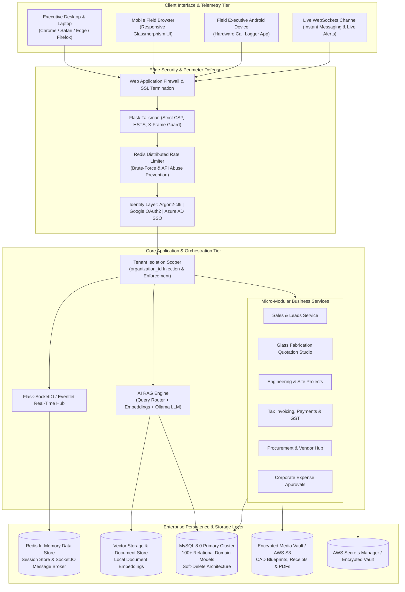
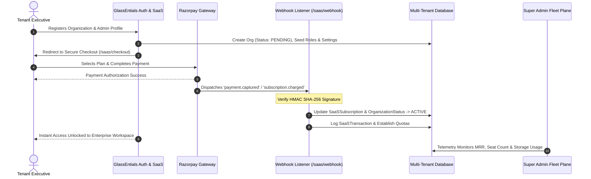
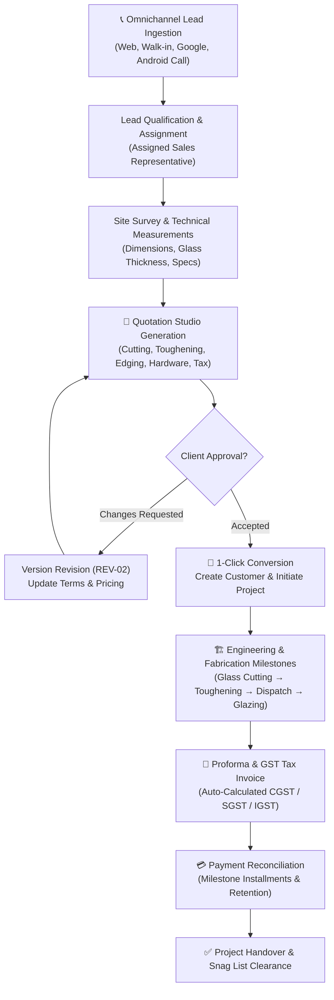
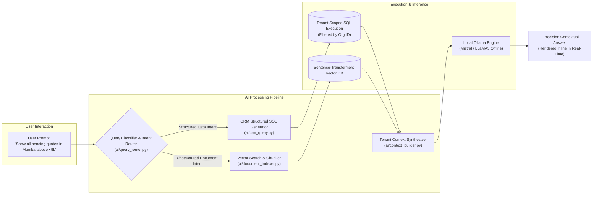
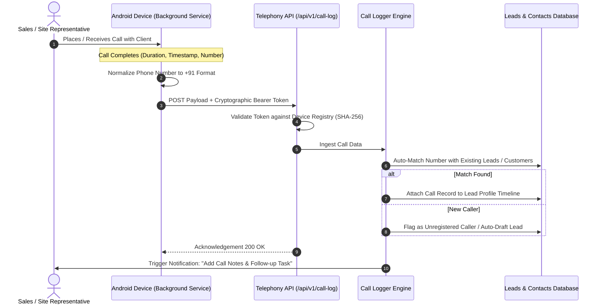
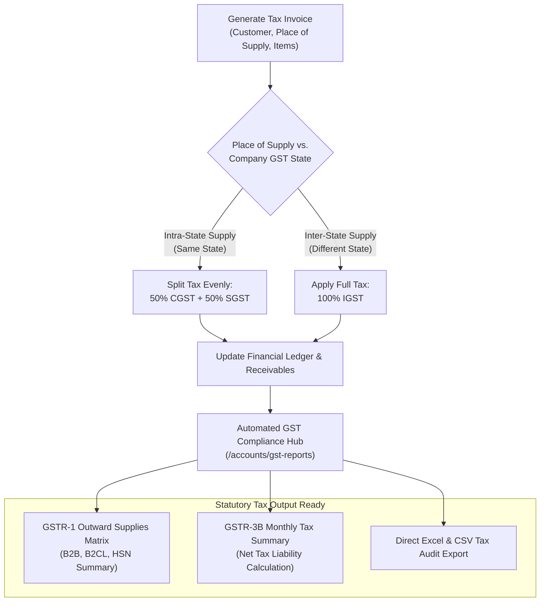
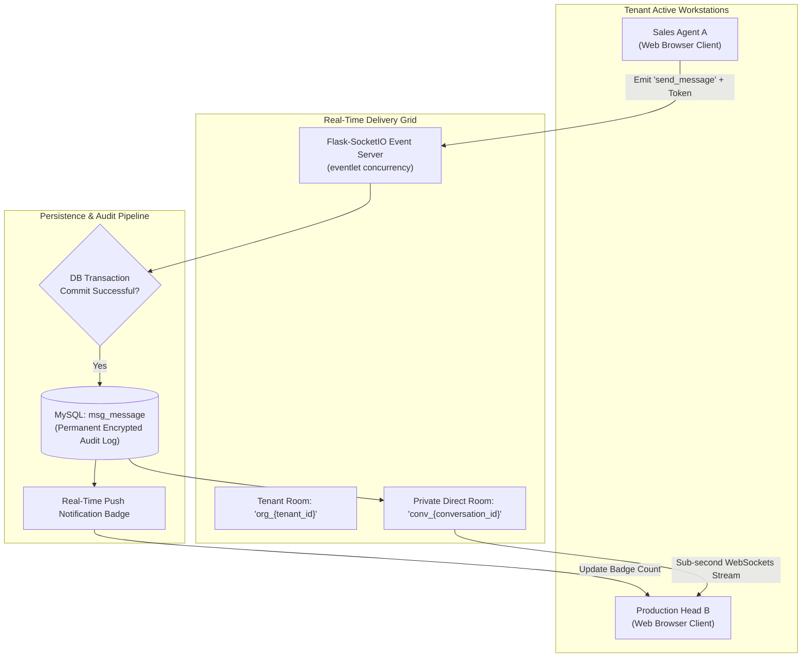
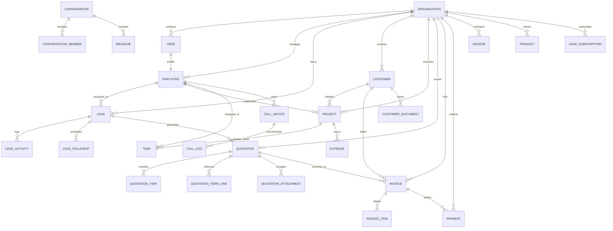

# <p align="center"><br>💎 GlassEntials Enterprise Cloud ERP & CRM</p>

<p align="center">
  <strong>The Industry-Leading, Multi-Tenant Intelligent Cloud Operating System Tailored for Glass Manufacturers, Architectural Glazing Contractors, and Global Mirror Enterprises.</strong>
</p>

<p align="center">
  <a href="#"></a>
  <a href="#"></a>
  <a href="#"></a>
  <a href="#"></a>
  <a href="#"></a>
  <a href="#"></a>
  <a href="#"></a>
  <a href="#"></a>
</p>

---

> ### 🔒 Proprietary & Confidential Enterprise Software
> **GlassEntials CRM & ERP** is a proprietary multi-tenant Software-as-a-Service (SaaS) cloud platform. This codebase and its architectural specifications represent proprietary intellectual property engineered specifically for high-throughput enterprise glazing, processing, and manufacturing organizations.

---

## 📑 Master Table of Contents

- [🏛️ Executive Architecture & System Topology](#️-executive-architecture--system-topology)
- [🔄 Enterprise System Workflows & Flowcharts](#-enterprise-system-workflows--flowcharts)
  - [1. Multi-Tenant SaaS Lifecycle & Billing Engine](#1-multi-tenant-saas-lifecycle--billing-engine)
  - [2. End-to-End Sales, Fabrication & Project Lifecycle](#2-end-to-end-sales-fabrication--project-lifecycle)
  - [3. Privacy-First AI Copilot RAG & Vector Engine](#3-privacy-first-ai-copilot-rag--vector-engine)
  - [4. Android Hardware Telephony Sync & Call Disposition](#4-android-hardware-telephony-sync--call-disposition)
  - [5. Financial Ledger, Invoicing & Indian GST Engine](#5-financial-ledger-invoicing--indian-gst-engine)
  - [6. Real-Time Collaboration & WebSockets Topology](#6-real-time-collaboration--websockets-topology)
- [🔥 Comprehensive Core Enterprise Modules](#-comprehensive-core-enterprise-modules)
  - [Module 1: 🤖 Private AI Copilot & Natural Language Query Engine](#module-1--private-ai-copilot--natural-language-query-engine)
  - [Module 2: 🏢 Multi-Tenant SaaS Subscriptions & Quota Management](#module-2--multi-tenant-saas-subscriptions--quota-management)
  - [Module 3: 🎯 Omnichannel Lead Management & Deal Pipeline](#module-3--omnichannel-lead-management--deal-pipeline)
  - [Module 4: 🤝 Client 360° Directory & Compliance Vault](#module-4--client-360-directory--compliance-vault)
  - [Module 5: 🏬 B2B Corporate Clients & Multi-City Branches](#module-5--b2b-corporate-clients--multi-city-branches)
  - [Module 6: 📜 Precision Quotation & Glass Fabrication Studio](#module-6--precision-quotation--glass-fabrication-studio)
  - [Module 7: 📦 Industrial Catalog & Dimensional Matrix](#module-7--industrial-catalog--dimensional-matrix)
  - [Module 8: 🏗️ Project Management & Site Engineering](#module-8--project-management--site-engineering)
  - [Module 9: 💰 Financials, Payments, Invoicing & GST Engine](#module-9--financials-payments-invoicing--gst-engine)
  - [Module 10: 🏷️ Corporate Expense & Reimbursement Workflow](#module-10--corporate-expense--reimbursement-workflow)
  - [Module 11: 🚚 Supply Chain & Vendor Hub](#module-11--supply-chain--vendor-hub)
  - [Module 12: 📞 Android Mobile Telephony Sync Gateway](#module-12--android-mobile-telephony-sync-gateway)
  - [Module 13: 💬 Internal Workspace Chat & Real-Time Comms](#module-13--internal-workspace-chat--real-time-comms)
  - [Module 14: 👑 Sovereign Super Admin Governance Control Plane](#module-14--sovereign-super-admin-governance-control-plane)
  - [Module 15: 🗄️ Enterprise Trash Station & Universal Audit Logs](#module-15--enterprise-trash-station--universal-audit-logs)
- [🛡️ Zero-Trust Security, Compliance & Data Isolation](#️-zero-trust-security-compliance--data-isolation)
- [📊 Enterprise Data Model & Entity Relationship (ERD)](#-enterprise-data-model--entity-relationship-erd)
- [⚙️ High-Throughput Technology Stack Specs](#️-high-throughput-technology-stack-specs)
- [📂 Codebase Organization & Topology](#-codebase-organization--topology)
- [🗺️ Future Architectural Roadmap](#️-future-architectural-roadmap)
- [📄 Governance, Copyright & Trademarks](#-governance-copyright--trademarks)

---

## 🏛️ Executive Architecture & System Topology

GlassEntials is engineered as a zero-leakage, multi-tenant cloud enterprise operating system. Each organization operates within a cryptographically isolated tenant envelope while sharing a unified, auto-scaling backend infrastructure.



---

## 🔄 Enterprise System Workflows & Flowcharts

### 1. Multi-Tenant SaaS Lifecycle & Billing Engine

The SaaS management engine automates organization onboarding, plan assignment, seat allocation, Razorpay recurring subscriptions, and quota enforcement.



---

### 2. End-to-End Sales, Fabrication & Project Lifecycle

From initial customer touchpoint through architectural estimation, conversion, fabrication, site installation, and financial settlement.



---

### 3. Privacy-First AI Copilot RAG & Vector Engine

The local RAG system allows executives to interrogate CRM datasets and indexed PDF blueprints with zero risk of commercial confidentiality leaks.



---

### 4. Android Hardware Telephony Sync & Call Disposition

Mobile telemetry bridges field operations and internal logs without manual reporting overhead.



---

### 5. Financial Ledger, Invoicing & Indian GST Engine

Automated calculation of complex Indian goods and service taxes across multi-state supply lines.



---

### 6. Real-Time Collaboration & WebSockets Topology

Internal enterprise communication designed to eliminate third-party chat apps while maintaining complete compliance auditability.



---

## 🔥 Comprehensive Core Enterprise Modules

### Module 1: 🤖 Private AI Copilot & Natural Language Query Engine
GlassEntials incorporates a state-of-the-art **air-gapped AI Copilot** designed to deliver instant operational intelligence without exposing proprietary corporate data to public APIs.
- **Local Neural Processing**: Seamlessly bridges with locally hosted **Ollama** backends (`mistral`, `llama3`, `deepseek`, `qwen`). No third-party data transmission.
- **Intelligent Query Classification**: Dissects natural language inputs into structured SQL queries for CRM data, vector lookups for indexed contracts/blueprints, or executive summaries.
- **Role-Aware Context Building**: Injects multi-tenant parameters and role permissions so users can only extract insights they are explicitly authorized to view.
- **Document Chunking & Vector Search**: Indexes specification sheets, CAD notes, and PDF contracts using `sentence-transformers` for instant clause retrieval.

### Module 2: 🏢 Multi-Tenant SaaS Subscriptions & Quota Management
Built from the ground up as a turnkey commercial enterprise SaaS platform.
- **Rigorous Tenant Partitioning**: Every database record is tethered to a unique `organization_id`. System-level interceptors prevent cross-tenant data traversal.
- **Subscription Lifecycle & Quotas**: Manage custom subscription plans featuring hard seat counts, quotation limits, storage volume caps, and feature toggles.
- **Automated Billing via Razorpay**: Turnkey integration handling plan upgrades, payment verification, recurring renewals, and automated tax invoicing.
- **Self-Serve Onboarding**: Automated organization initialization wizard configuring corporate metadata, user roles, initial branches, and custom quotation styling.

### Module 3: 🎯 Omnichannel Lead Management & Deal Pipeline
Maximize sales throughput with an advanced conversion pipeline engineered for architectural glass projects.
- **Omnichannel Ingestion**: Automatically aggregate leads from digital advertising, showroom walk-ins, phone logs, and bulk CSV imports.
- **Dynamic Sales Funnel**: Manage deal progression through customizable stages (*New*, *Contacted*, *Survey Scheduled*, *Quotation Sent*, *Negotiation*, *Won/Lost*).
- **Intelligent Representative Balancing**: Assign leads based on staff capacity, regional focus, or deal size, complete with automated follow-up SLA reminders.
- **Instant Search & Deep Filtering**: Search across client names, contact numbers, emails, and statuses in real time.

### Module 4: 🤝 Client 360° Directory & Compliance Vault
A comprehensive single-pane repository for managing enterprise client relationships.
- **Unified Client Dossier**: Complete historical view encompassing quotations, active project sites, billing ledgers, and site visit logs.
- **Statutory GSTIN Validation**: Algorithmic validation ensuring customer Tax Identification Numbers adhere to statutory standards.
- **Compliance & Agreement Vault**: Securely archive site measurement sheets, architectural CAD drawings, tax exemptions, and completion sign-offs.
- **High-Performance Data Portability**: Streamlined bulk ingestion engine with error validation, plus 1-click export to CSV, Excel, and PDF.

### Module 5: 🏬 B2B Corporate Clients & Multi-City Branches
Engineered specifically for complex corporate relationships with developers, contractors, and hotel chains.
- **Parent-Child Corporate Trees**: Map corporate headquarters to regional branches, construction sites, and local franchises.
- **Regional Coverage Mapping**: Assign dedicated points of contact and sales engineers to specific metropolitan zones.
- **Stakeholder Registry**: Maintain an organizational directory of Project Directors, Site Engineers, and Billing Officers with direct communication links.

### Module 6: 📜 Precision Quotation & Glass Fabrication Studio
The signature capability of GlassEntials — a specialized calculation engine built for glass processing and installation.
- **Architectural Glass Pricing Formulas**: Dynamic calculation handling area (sqft/sqm), glass thickness (4mm through 19mm), toughening, double-glazing (DGU), laminated security glass, frosted finishes, and edge polish.
- **Dynamic Hardware Bundling**: Calculate custom fittings, spider brackets, patch fittings, floor springs, shower hinges, and architectural railings.
- **Terms & Legal Library**: Pre-built, customizable repository of payment milestones, fabrication tolerances, delivery timelines, and breakage insurance clauses.
- **Audit-Proof Revisions & Digital Signatures**: Manage version histories (`REV-01`, `REV-02`) with integrated cryptographic representative signatures and luxury PDF generation.

### Module 7: 📦 Industrial Catalog & Dimensional Matrix
Complete SKU and materials cataloging designed for glass and fabrication hardware.
- **Multi-Level Categorization**: Organize products across Raw Float Sheets, Processed Glass, Hardware Fittings, Aluminum Profiles, and Consumables.
- **Multi-Dimensional Units of Measurement (UoM)**: Full native support for Sq. Feet, Sq. Meters, Running Feet, Metric Tons, Boxes, and Individual Units.
- **HSN / SAC Code Taxonomy**: Pre-configured HSN codes guaranteeing instant accuracy on all outbound tax invoices.

### Module 8: 🏗️ Project Management & Site Engineering
Connect commercial promises with physical shop-floor and on-site realities.
- **Fabrication Milestones**: Track progress across *Site Survey*, *CAD Drafting*, *Glass Cutting*, *Toughening & Laminating*, *Dispatch*, and *On-Site Glazing*.
- **Field Crew Delegation**: Assign site supervisors, glaziers, and safety managers with performance logs and accountability tracking.
- **Budget vs. Actual Variance**: Continuous tracking comparing quoted estimates with real-world material consumption, labor hours, and sub-contractor costs.
- **Engineering Vault**: Dedicated repository for structural wind-load certificates, CAD drawings, site images, and client snag list approvals.

### Module 9: 💰 Financials, Payments, Invoicing & GST Engine
End-to-end statutory Indian financial accounting and receivables management.
- **GST Tax Invoices & Proformas**: Generate compliant tax invoices with automated split calculation for CGST, SGST, and IGST based on place of supply.
- **Milestone Payment Tracking**: Track advance bookings, fabrication installments, delivery balances, and retention funds with sequential numbering (`PAY-XXXXX`).
- **Payment Instrument Tracking**: Log NEFT, RTGS, IMPS, UPI, Cheques, and Cash with clearance tracking and bank transaction reference reconciliation.
- **GSTR-1 & GSTR-3B Reporting**: Built-in tax engine generating comprehensive monthly and annual GST summaries ready for direct accountant export.

### Module 10: 🏷️ Corporate Expense & Reimbursement Workflow
Maintain strict control over site outlays, operational travel, and procurement expenses.
- **Expense Categorization**: Site travel, tooling, client hospitality, logistical haulage, and machinery maintenance.
- **Multi-Stage Approval Hierarchy**: Role-restricted approval pipelines (*Pending*, *Approved*, *Rejected*, *Reimbursed*).
- **Digital Receipt Capture**: Built-in receipt viewer preventing unauthorized or unverified corporate expense claims.

### Module 11: 🚚 Supply Chain & Vendor Hub
Centralized procurement management for raw glass floats, interlayers, and hardware suppliers.
- **Vendor Due Diligence**: Store vendor banking profiles, MSME certificates, GSTIN registrations, and verification statuses.
- **Credit Terms & Schedules**: Enforce credit cycles (Net 15, Net 30, Net 60, Advance) to safeguard corporate liquidity.
- **Procurement Activity Trail**: Log price quotations, purchase orders, and supplier delivery performance metrics.

### Module 12: 📞 Android Mobile Telephony Sync Gateway
Direct integration between executive cellular activity and CRM client timelines.
- **Android Companion Sync Service**: Background service logging outgoing, incoming, and missed calls directly to the platform.
- **Cryptographic Device Pairing**: Handshake authentication using SHA-256 hashed Bearer tokens with instant remote revocation.
- **Intelligent Number Normalization**: Automatic formatting of Indian phone numbers (`+91`), instantly matching incoming calls to existing customer profiles.
- **Automated Call Outcomes**: Tag call outcomes (*Connected*, *Site Visit Agreed*, *Busy*, *Call Back Later*) and trigger automated follow-up calendar tasks.

### Module 13: 💬 Internal Workspace Chat & Real-Time Comms
High-performance internal communication keeping sensitive company chatter within corporate boundaries.
- **Instant WebSockets Grid**: Powered by `Flask-SocketIO` and `eventlet` for sub-second, bidirectional messaging.
- **Channel Architecture**: 1-on-1 direct employee messaging, project coordination channels, and broadcast feeds.
- **Media & Document Dispatch**: Securely exchange site measurements, CAD drawings, and quotation drafts inline.
- **Strict Tenant Separation**: Cryptographically isolated rooms guarantee that messages never cross organization boundaries.

### Module 14: 👑 Sovereign Super Admin Governance Control Plane
Master command center (`/admin`) for platform operators and SaaS system administrators.
- **Isolated Control Plane**: Completely decoupled from standard tenant routes with dedicated URL schemes and independent authentication guards.
- **Two-Factor Cryptographic OTP**: 6-digit email-dispatched one-time password required on every admin session initialization.
- **Fleet-Wide Telemetry**: Real-time dashboards monitoring total active tenants, MRR (Monthly Recurring Revenue), active subscriptions, and server load.
- **Tenant Lifecycle Governance**: Provision new enterprise accounts, suspend delinquent organizations, adjust quotas, and inspect cross-tenant audit trails.

### Module 15: 🗄️ Enterprise Trash Station & Universal Audit Logs
Safeguard operational integrity with universal soft deletion and immutable audit trails.
- **Universal Soft-Delete Engine**: Data is never deleted with raw `DELETE` SQL commands; records are tagged with an `is_deleted` flag.
- **Central Recovery Station (`/workplace/trash`)**: Centralized trash manager allowing authorized managers to search, inspect, and 1-click restore records.
- **Granular Audit Ledger**: Every update, status transition, creation, and soft deletion records the actor, IP address, timestamp, and field-level diff snapshot.

---

## 🛡️ Zero-Trust Security, Compliance & Data Isolation

```mermaid
flowchart LR
    subgraph IngressProtection["Ingress & Edge Defense"]
        TalismanCSP["Strict Content Security Policy\n(Flask-Talisman)"]
        HSTS["HTTP Strict Transport Security\n(HSTS Preload Ready)"]
        RedisLimiter["Redis Distributed Rate Limiter\n(Brute-Force Shield)"]
        CSRF["Flask-WTF CSRF Token\n(Synchronizer Token Pattern)"]
    end

    subgraph AuthSecurity["Authentication & Identity Guard"]
        Argon2["Argon2-cffi Password Hashing\n(OWASP Recommended)"]
        OAuth["Google OAuth 2.0 &\nMicrosoft Azure AD SSO"]
        SessionGuard["HttpOnly + SameSite=Lax\nSecure Session Cookies"]
        SuperOTP["2-Factor Email OTP\n(Super Admin Portal)"]
    end

    subgraph TenantIsolation["Data & Tenant Boundary"]
        TenantDecorator["@tenant_record_id Decorator\n(Strict Cross-Tenant Guard)"]
        RBAC["Granular UserRole Matrix\n(Admin, Manager, Staff, Glazier)"]
        AuditLogging["Immutable Audit Trail\n(Actor, IP, Timestamp, Diff)"]
    end

    IngressProtection --> AuthSecurity --> TenantIsolation
```



1. **Argon2-cffi Password Hashing**: Winner of the Password Hashing Competition; delivers high resistance to GPU/ASIC brute-force cracking.
2. **Enterprise Single Sign-On (SSO)**: Built-in OAuth 2.0 connectors for Google Workspace and Microsoft Entra ID (Azure AD).
3. **Session & CSRF Protection**: Every session is protected with `HttpOnly`, `SameSite=Lax`, secure cookie flags, and unique CSRF tokens.
4. **Tenant Scoping Decorators**: Controllers utilize the `@tenant_record_id` and `@require_roles` decorators to verify that accessed resource IDs strictly belong to `current_user.organization_id`.
5. **AWS Secrets Manager Integration**: Production deployments support runtime credential retrieval directly from AWS Secrets Manager, eliminating plain-text secrets in the filesystem.

---

## 📊 Enterprise Data Model & Entity Relationship (ERD)

The GlassEntials relational core spans **over 100 domain models and enumerations**, structured around strict multi-tenant isolation.



---

## ⚙️ High-Throughput Technology Stack Specs

| Architectural Layer | Core Technologies & Runtime Specs | Purpose & Enterprise Role |
|---|---|---|
| **Core Application Runtime** | **Python 3.13** & **Flask 3.0.3** | High-performance asynchronous WSGI server core |
| **Real-Time WebSockets Engine** | **Flask-SocketIO 5.3.6** & **eventlet 0.33.3** | Bidirectional low-latency event delivery & live chat |
| **Relational Database Tier** | **MySQL 8.0+** & **SQLAlchemy 2.0.31** | Acid-compliant enterprise multi-tenant data storage |
| **Database Migrations** | **Alembic** & **Flask-Migrate 4.0.7** | Zero-downtime schema evolution and version tracking |
| **Distributed Cache & Queuing** | **Redis 5.0.4** & **redis-py** | Socket.IO message broadcasting & distributed rate limiting |
| **Cryptography & Security** | **argon2-cffi 23.1.0** & **Flask-Talisman 1.1.0** | OWASP-grade password hashing, CSP & HSTS security |
| **Local AI & Semantic RAG** | **Ollama** (Mistral/LLaMA3), **sentence-transformers 3.3.1** | Air-gapped AI Copilot, vector search & document indexing |
| **Financial & Export Processing**| **Pandas 2.2.2**, **openpyxl 3.1.2**, **fpdf2 2.7.9** | GSTR Excel generator & luxury quotation PDF engine |
| **Payment Gateway Suite** | **Razorpay 1.4.1** SDK & Secure Webhooks | Automated multi-tier SaaS billing & transaction validation |
| **Cloud Infrastructure Connect** | **Boto3 1.34.0** (AWS Secrets Manager & S3) | Production secret rotation & encrypted document storage |
| **Custom UI Design System** | **Handcrafted Glassmorphic Vanilla CSS & ES6+** | Proprietary luxury dark theme UI (Zero bulky bloatware) |

---

## 📂 Codebase Organization & Topology

```
CRM-GlassEntials/
│
├── ai/                              # 🧠 AI Copilot RAG & Intelligence Core
│   ├── ai_service.py                # Top-level AI orchestration service
│   ├── context_builder.py           # Database context and prompt synthesis
│   ├── crm_query.py                 # Structured semantic DB query engine
│   ├── document_indexer.py          # Document parsing, chunking & indexing
│   ├── embeddings.py                # Vector embedding generation (sentence-transformers)
│   ├── llm_provider.py              # Local Ollama / LLM abstraction layer
│   ├── query_router.py              # Intent classification (CRM vs Doc vs Chat)
│   └── vector_store.py              # In-memory / persistent vector index
│
├── routes/                          # 🌐 Modular Blueprint Controllers
│   ├── accounts.py                  # Invoicing, proformas, accounting summaries
│   ├── ai_chat.py                   # AI Copilot interactive chat endpoints
│   ├── api.py                       # REST API (notifications, GST checks, autocompletes)
│   ├── auth.py                      # Multi-tenant registration, Argon2 login, sessions
│   ├── call_logger.py               # Call telemetry dashboard & device manager
│   ├── call_logger_api.py           # Android companion app REST API
│   ├── contacts.py                  # Contact records management
│   ├── customers.py                 # Customer 360 directory & file vaults
│   ├── documents.py                 # Central corporate file manager
│   ├── employees.py                 # Employee roster, roles & permission mapping
│   ├── expenses.py                  # Corporate expense approvals & reimbursement
│   ├── google_auth.py               # Google OAuth 2.0 SSO flow
│   ├── gst_reports.py               # Indian GST summary & export engine
│   ├── leads.py                     # Lead capture, pipeline & conversion
│   ├── messages.py                  # Socket.IO real-time internal messaging
│   ├── microsoft_auth.py            # Azure AD (Microsoft Entra ID) SSO flow
│   ├── org.py                       # Organization profile, branding & settings
│   ├── org_customers.py             # Corporate B2B accounts & branch networks
│   ├── password_reset.py            # Secure token-based password recovery
│   ├── payments.py                  # Payment entries, receipts, reconciliation
│   ├── products.py                  # Inventory catalog, UoM & pricing rules
│   ├── projects.py                  # Architectural project milestones & operations
│   ├── quotations.py                # Glass fabrication estimation & PDF generator
│   ├── quotation_settings.py        # Terms library, custom fields & tax rules
│   ├── saas.py                      # SaaS subscription checkout & Razorpay webhooks
│   ├── tasks.py                     # Employee tasks, follow-up scheduler & daily logs
│   ├── trash.py                     # Centralized soft-delete recovery station
│   └── vendors.py                   # Supplier management & procurement tracking
│
├── super_admin/                     # 👑 Platform Fleet Governance Plane
│   ├── auth.py                      # Super Admin login & 2FA OTP verification
│   ├── decorators.py                # Route guard decorators
│   ├── routes.py                    # Fleet telemetry, tenant onboarding & controls
│   └── templates/                   # Dedicated Super Admin UI views
│
├── services/                        # ⚙️ Reusable Business Logic Services
│   ├── gst_export_service.py        # Excel/CSV GSTR calculation engine
│   ├── oauth_service.py             # Social auth token resolution
│   └── org_limits.py                # Tenant quota enforcement
│
├── utils/                           # 🛡️ Utilities, Helpers & Security Guards
│   ├── activity.py                  # Enterprise activity logging & diff tracking
│   ├── email_service.py             # Transactional HTML email sender
│   ├── gst.py                       # GSTIN algorithm verification
│   ├── number_words.py              # Currency to words converter (Indian numbering)
│   ├── quotation_pdf.py             # High-precision fpdf2 PDF canvas engine
│   ├── security.py                  # RBAC decorators & path validation
│   ├── tenant.py                    # Multi-tenant context helpers
│   ├── timezone.py                  # Indian Standard Time (IST) localization
│   └── trash.py                     # Universal model soft-delete & restore engine
│
├── static/                          # 🎨 Handcrafted Luxury Design System
│   ├── css/                         # Custom Glassmorphic styles (home.css, etc.)
│   ├── js/                          # Client-side reactivity, debounce search & UI scripts
│   └── img/                         # Brand identity, icons & default assets
│
├── templates/                       # 🖥️ Jinja2 Enterprise UI Templates
│   ├── accounts/                    # Invoices, balance sheets, GST reports
│   ├── call_logger/                 # Telephony views & device pairing
│   ├── customer/                    # Customer profiles & document tabs
│   ├── home/                        # Executive dashboard & marketing landing
│   ├── leads/                       # Sales pipeline, kanban & detail views
│   ├── messages/                    # Socket.IO chat windows & direct channels
│   ├── org_customers/               # Enterprise B2B client trees & branches
│   ├── projects/                    # Project trackers & milestone boards
│   ├── tasks/                       # Task lists, follow-ups & daily reports
│   ├── trash/                       # Central trash recovery station
│   └── vendors/                     # Supplier management views
│
├── app.py                           # 🚀 Application factory, socket initialization
├── config.py                        # Centralized environment & AWS config
├── model.py                         # 🗄️ 100+ Enterprise SQLAlchemy Domain Models
├── requirements.txt                 # Frozen production dependency list
└── README.md                        # Master Technical Documentation
```

---

## 🗺️ Future Architectural Roadmap

- [x] **Phase 1: Multi-Tenant Foundation & RBAC Isolation**
- [x] **Phase 2: Architectural Glass Fabrication Estimation Studio**
- [x] **Phase 3: Automated Indian GST Accounting & GSTR-1/3B Compliance Engine**
- [x] **Phase 4: SaaS Subscription Engine & Razorpay Webhook Gateway**
- [x] **Phase 5: Android Mobile Hardware Telephony Sync Gateway**
- [x] **Phase 6: Real-Time Bidirectional WebSockets Messaging Grid**
- [x] **Phase 7: Air-Gapped Local Vector AI Copilot (Ollama + RAG)**
- [ ] **Phase 8: WhatsApp Cloud API Integration** (Automated quotation delivery and payment reminders)
- [ ] **Phase 9: Barcode & QR Code Inventory Scanning** (Warehouse dispatch and site delivery verification)
- [ ] **Phase 10: Native Flutter Mobile Application** (Unified iOS and Android executive suite)

---

## 📄 Governance, Copyright & Trademarks

This codebase, technical architecture, UI design system, and documentation are proprietary and confidential.

- **Platform**: GlassEntials Cloud ERP & CRM Suite
- **Architect & Principal Engineer**: Ratandeep
- **Copyright**: © GlassEntials Enterprise Solutions. All rights reserved.
- **Usage Notice**: Unauthorized duplication, decompilation, distribution, or public hosting of this software without explicit commercial licensing is strictly prohibited.

---

<p align="center">
  <em>"In the glass enterprise, every millimeter counts, and every shard of data matters."</em><br>
  <strong>GlassEntials CRM & ERP — Built for Precision. Scaled for Industry.</strong>
</p>
