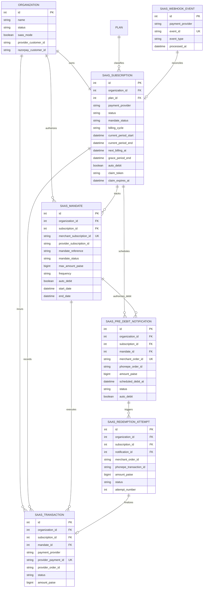
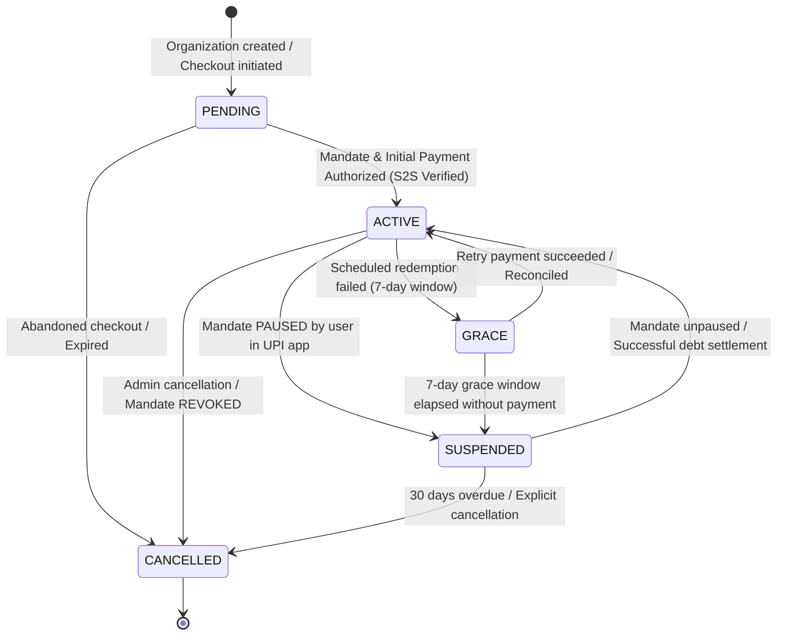
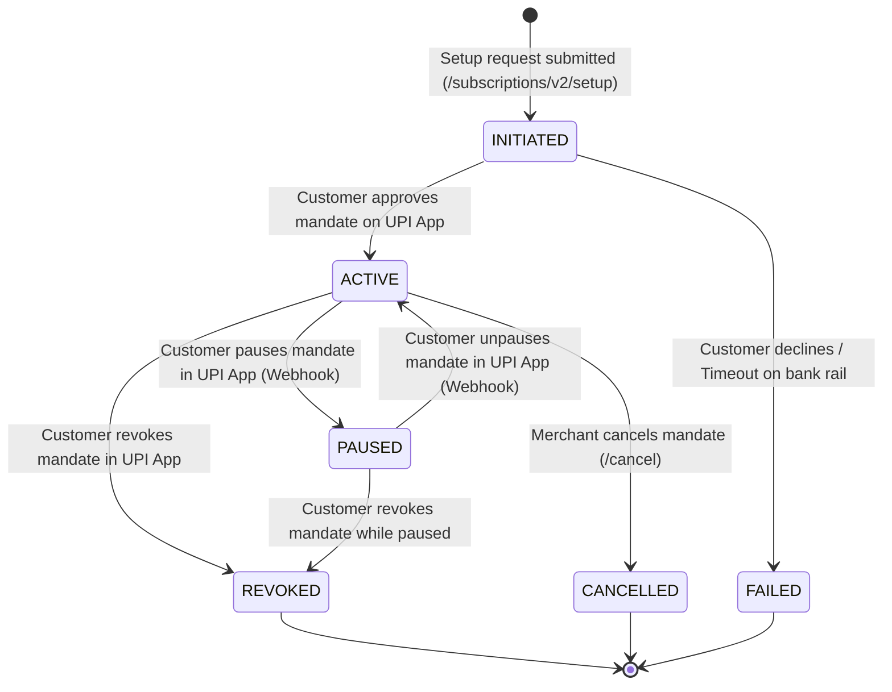
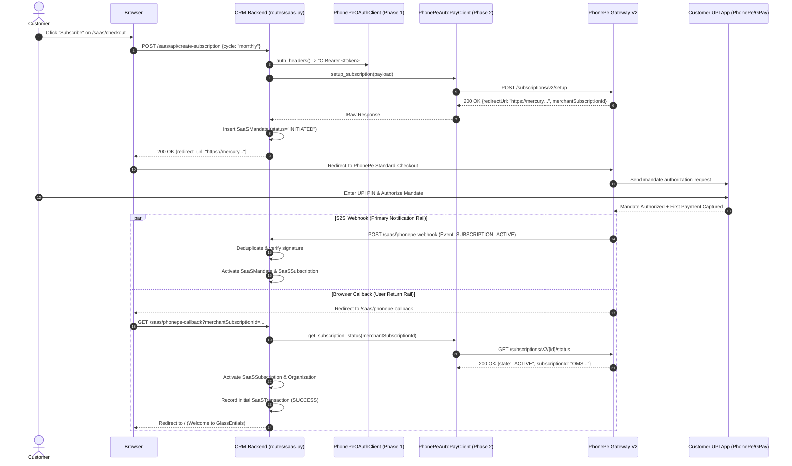
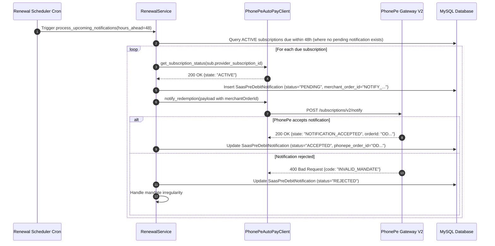

# PhonePe AutoPay V2: Database & Subscription Lifecycle Architecture

**Document Version:** 1.0.0  
**Phase:** 3 — Architecture Analysis & Design  
**Target Repository:** `Glass-Entials/CRM-Glass-Entials`  
**Status:** PROPOSED (Pending Review & Explicit Approval)  
**Author:** AI Architecture Team  
**Date:** November 2026  

---

## Executive Summary

This document specifies the target **Database Architecture, Subscription Lifecycle Engine, Concurrency Safeguards, and Webhook Architecture** for migrating GlassEntials CRM from legacy payment integrations to **PhonePe AutoPay V2 (Standard Checkout Subscriptions)**.

### Strict Architectural Boundaries for Phase 3:
1. **Design Only**: No application code, database migrations, model modifications, or route modifications are executed during Phase 3.
2. **Zero Regression for Razorpay**: All existing Razorpay database fields, migration histories, payment logs, and configuration variables remain **100% untouched and preserved**.
3. **Preservation of PhonePe V3**: The existing `PhonePeProvider` (legacy V3 X-VERIFY checksum based) remains operational as a fallback; the new V2 architecture introduces a modular, parallel provider (`PhonePeAutoPayV2Provider`) powered by the Phase 1 OAuth Client (`PhonePeOAuthClient`) and Phase 2 API Client (`PhonePeAutoPayClient`).

---

## Table of Contents

1. [Existing Architecture Audit](#1-existing-architecture-audit)
2. [Current Billing Flow & Deficiencies](#2-current-billing-flow--deficiencies)
3. [Proposed System Architecture](#3-proposed-system-architecture)
4. [Database Schema Design](#4-database-schema-design)
5. [Entity Relationship Diagram](#5-entity-relationship-diagram)
6. [Subscription & Mandate Lifecycle State Machines](#6-subscription--mandate-lifecycle-state-machines)
7. [Payment & Redemption Sequence Diagrams](#7-payment--redemption-sequence-diagrams)
8. [Webhook Processing Architecture](#8-webhook-processing-architecture)
9. [Financial Safety, Idempotency & Concurrency Strategy](#9-financial-safety-idempotency--concurrency-strategy)
10. [API Integration Mapping](#10-api-integration-mapping)
11. [Failure Handling & Reconciliation Engine](#11-failure-handling--reconciliation-engine)
12. [Database Migration Strategy](#12-database-migration-strategy)
13. [Tenant Isolation & Security Architecture](#13-tenant-isolation--security-architecture)
14. [Testing Strategy](#14-testing-strategy)
15. [Implementation Roadmap](#15-implementation-roadmap)
16. [Open Questions, Gateway Dependencies & Risks](#16-open-questions-gateway-dependencies--risks)

---

## 1. Existing Architecture Audit

The GlassEntials CRM SaaS billing module is built on **Flask + SQLAlchemy + MySQL 8.0**. Below is the audit of existing components:

### 1.1 Data Models (`model.py`)
- **`Organization` (`organization`)**:
  - Acts as the multi-tenant root entity.
  - Fields include `status` (`OrganizationStatus`: `PENDING`, `ACTIVE`, `GRACE`, `SUSPENDED`, `ARCHIVED`, `CANCELLED`), `saas_mode` (boolean), `provider_customer_id` (VARCHAR 100), and `razorpay_customer_id` (VARCHAR 100).
  - Relationships: 1-to-1 with `SaaSSubscription`, 1-to-many with `SaaSTransaction`.
- **`Plan` (`plan`)**:
  - Defines SaaS tiers (`Basic`, `Professional`, `Enterprise`).
  - Fields: `monthly_price_paise` (BIGINT), `yearly_price_paise` (BIGINT), `features_json`, legacy `razorpay_monthly_plan_id`, `razorpay_yearly_plan_id`.
- **`SaaSSubscription` (`saas_subscription`)**:
  - Tracks organization subscriptions. Unique constraint on `organization_id` (1 subscription per org).
  - Fields: `payment_provider` (`'phonepe'`, `'razorpay'`), `provider_subscription_id` (unique), `provider_order_id`, `provider_transaction_id`, `provider_customer_reference`, `mandate_reference` (holds UPI UMN), `amount_paise`, `currency`, `status` (`SaaSSubscriptionStatus`), `billing_cycle` (`MONTHLY`, `YEARLY`).
  - Dates: `current_period_start`, `current_period_end`, `next_billing_at`, `grace_period_end`, `cancelled_at`.
  - Legacy fields: `razorpay_subscription_id`, `razorpay_plan_id`.
- **`SaaSTransaction` (`saas_transaction`)**:
  - Immutable ledger of all payment attempts and successes.
  - Fields: `organization_id`, `subscription_id`, `payment_provider`, `provider_payment_id` (unique), `provider_order_id`, `provider_transaction_id`, `provider_subscription_id`, `amount_paise`, `currency`, `status` (`SaaSTransactionStatus`: `SUCCESS`, `FAILED`, `PENDING`, `REFUNDED`), `payment_method`, `failure_reason`.
  - Legacy fields: `razorpay_payment_id`, `razorpay_invoice_id`, `razorpay_subscription_id`, `razorpay_event_id`.
- **`SaaSWebhookEvent` (`saas_webhook_event`)**:
  - Idempotency store for inbound webhooks.
  - Fields: `id`, `payment_provider`, `event_id` (unique), `event_type`, `processed_at`, `payload_summary`.

### 1.2 Domain Services (`services/billing/`)
- **`SubscriptionService`**: Orchestrates mandate initiation, activation, suspension, cancellation, and grace period entry.
- **`TransactionService`**: Records transactions, provides idempotency lookups on `provider_payment_id`.
- **`RenewalService`**: Handles pre-debit notifications (PDN) and recurring redemptions. Executes atomic next-billing advancement (30-minute lock window).
- **`BillingService`**: Factory that returns a singleton instance of `PaymentProvider` based on `BILLING_DEFAULT_PROVIDER`.

### 1.3 HTTP Endpoints (`routes/saas.py`)
- `GET /saas/checkout`: Renders checkout page for organizations with `OrganizationStatus.PENDING`.
- `POST /saas/api/create-subscription`: Initiates mandate creation and returns the redirect URL.
- `GET / POST /saas/phonepe-callback`: Browser return URL from PhonePe checkout. Executes S2S transaction inquiry before activating organization.
- `POST /saas/api/verify-payment`: Client-side verification endpoint.
- `POST /saas/phonepe-webhook`: Receives asynchronous S2S notifications. Exempt from CSRF (`csrf.exempt(saas_bp)` in `app.py`).
- `POST /saas/api/process-renewals`: Cron trigger endpoint protected by `RENEWAL_CRON_SECRET` using `hmac.compare_digest`.

### 1.4 Existing Database Migrations
- `cde1a282101c_saas_billing_add_saassubscription_.py`: Created baseline SaaS tables with Razorpay integration.
- `b7e9a1c2d3f4_saas_billing_phonepe_autopay_migration.py`: Introduced provider-agnostic columns (`provider_subscription_id`, `payment_provider`, etc.) and preserved legacy Razorpay rows.

---

## 2. Current Billing Flow & Deficiencies

### 2.1 Current V3 Execution Flow
```
[Customer Checkout]
       │
       ▼
SubscriptionService.initiate_subscription()
       │
       ▼
PhonePeProvider.create_subscription_mandate() (/v3/recurring/subscription/create)
       │
       ▼
Redirect to PhonePe Standard Checkout Page
       │
       ▼
Customer approves UPI Mandate in UPI App (PhonePe, GPay, etc.)
       │
       ▼
Browser redirected to /saas/phonepe-callback
       │
       ▼
Authoritative S2S Check: PhonePeProvider.check_transaction_status()
       │
       ▼
SubscriptionService.activate_subscription() -> Org ACTIVE, SaaSSubscription ACTIVE
```

### 2.2 Deficiencies Discovered in Current Implementation

| Area | Current Implementation Defect | Consequence in Production |
|---|---|---|
| **Mandate vs Subscription Coupling** | `SaaSSubscription` has a 1-to-1 relationship with `Organization` and directly holds `provider_subscription_id` with a UNIQUE constraint. | If a customer's mandate fails or is cancelled, and they try to set up a new mandate, the unique constraint conflicts with past history or destroys historical mandate tracking. |
| **Notification Persistence Gap** | `RenewalService.process_upcoming_notifications` calls PhonePe Notify, but **does not record the resulting notification in the database**. | In V2, `redeem()` **requires the exact `merchantOrderId`** generated during `notify()`. Without storing the notification order in the DB, `redeem()` has no reliable state to read from. |
| **AutoDebit Flag Ignored** | Current code assumes all redemptions must be manually executed by `RenewalService`. | In PhonePe AutoPay V2, when `autoDebit: true`, calling `redeem()` triggers an error (`MANDATE_ALREADY_PROCESSING` or duplicate debit). The system must respect whether the mandate is configured for automated gateway debit or merchant-initiated debit. |
| **Lack of Mandate History** | Customer mandate pause/resume events overwrite `SaaSSubscription.status`. | If a customer pauses their mandate on their UPI app, CRM cannot distinguish between "Subscription suspended for non-payment" and "Mandate paused temporarily by customer in PhonePe app". |
| **Concurrency Lock Limitation** | `sub.next_billing_at = now + 30m` is used as an in-flight lock. | If two workers execute concurrently, both can read the same rows before the update occurs unless database row-level locking (`SELECT FOR UPDATE`) or a dedicated atomic claim token is used. |

---

## 3. Proposed System Architecture

To support PhonePe AutoPay V2 cleanly without breaking Razorpay or legacy PhonePe V3, we adopt a **modular provider architecture**:

```
                              ┌─────────────────────────────────────────────────────────┐
                              │                    Flask Routes Layer                   │
                              │                    (routes/saas.py)                     │
                              └────────────────────────────┬────────────────────────────┘
                                                           │
                                                           ▼
                              ┌─────────────────────────────────────────────────────────┐
                              │                  Billing Service Factory                │
                              │            (services/billing/billing_service.py)         │
                              └──────┬─────────────────────┬─────────────────────┬──────┘
                                     │                     │                     │
                     provider="razorpay"          provider="phonepe"    provider="phonepe_v2"
                                     │                     │                     │
                                     ▼                     ▼                     ▼
                       ┌──────────────────────┐  ┌───────────────────┐  ┌───────────────────────────┐
                       │ Razorpay Integration │  │ PhonePeProvider   │  │ PhonePeAutoPayV2Provider  │
                       │   (Legacy / Frozen)  │  │ (Legacy V3 Check) │  │ (AutoPay V2 Standard Flow)│
                       └──────────────────────┘  └───────────────────┘  └─────────────┬─────────────┘
                                                                                      │
                                                                       ┌──────────────┴──────────────┐
                                                                       ▼                             ▼
                                                        ┌─────────────────────────────┐ ┌───────────────────────────┐
                                                        │     PhonePeOAuthClient      │ │   PhonePeAutoPayClient    │
                                                        │  (Phase 1 Token Management) │ │  (Phase 2 REST Endpoints) │
                                                        └─────────────────────────────┘ └───────────────────────────┘
```

### 3.1 Architectural Principles:
1. **Decoupled Providers**: `PhonePeAutoPayV2Provider` implements the standard `PaymentProvider` abstract interface.
2. **Persistence Normalization**: Mandates and Pre-Debit Notifications are modeled as explicit database entities linked to `SaaSSubscription`.
3. **Stateless Gateway Communication**: `PhonePeAutoPayClient` remains a thin transport layer; all lifecycle logic, transaction updates, and retry policies reside in domain services.
4. **Tenant Isolation**: Every database query is strictly filtered by `organization_id`.

---

## 4. Database Schema Design

We propose an additive, backward-compatible schema enhancement. Existing tables are extended safely; new companion tables provide normalized mandate and notification tracking.

### 4.1 Extended Table: `saas_subscription`
Extends the existing `saas_subscription` table to track AutoPay V2 specific lifecycle data.

```sql
ALTER TABLE saas_subscription
    ADD COLUMN auto_debit BOOLEAN NOT NULL DEFAULT FALSE COMMENT 'True if PhonePe executes recurring debits automatically',
    ADD COLUMN mandate_status VARCHAR(50) NOT NULL DEFAULT 'PENDING' COMMENT 'PENDING, ACTIVE, PAUSED, REVOKED, CANCELLED',
    ADD COLUMN active_mandate_id VARCHAR(100) NULL COMMENT 'References provider_mandate_id of current active mandate',
    ADD COLUMN claim_token VARCHAR(64) NULL COMMENT 'Worker claim UUID for atomic scheduler concurrency',
    ADD COLUMN claim_expires_at DATETIME NULL COMMENT 'Expiry timestamp of worker claim',
    ADD INDEX ix_saas_sub_mandate_status (mandate_status),
    ADD INDEX ix_saas_sub_claim (claim_token, claim_expires_at);
```

### 4.2 New Table: `saas_mandate`
Maintains a complete audit history of all UPI AutoPay mandates ever created for an organization. Solves the unique constraint conflict when customers cancel and resubscribe.

| Column | Type | Constraints | Description |
|---|---|---|---|
| `id` | INT AUTO_INCREMENT | PK | Internal record identifier |
| `organization_id` | INT | FK (`organization.id`), NOT NULL, INDEX | Tenant owner |
| `subscription_id` | INT | FK (`saas_subscription.id`), NOT NULL, INDEX | Target SaaS subscription |
| `payment_provider` | VARCHAR(50) | NOT NULL, DEFAULT `'phonepe_v2'` | Gateway provider identifier |
| `merchant_subscription_id` | VARCHAR(100) | NOT NULL, UNIQUE, INDEX | Merchant identifier sent to PhonePe (`MSUB_{orgId}_{ts}`) |
| `provider_subscription_id` | VARCHAR(100) | NULL, INDEX | PhonePe's internal subscription ID |
| `mandate_reference` | VARCHAR(100) | NULL, INDEX | NPCI Unique Mandate Number (UMN) |
| `mandate_status` | VARCHAR(50) | NOT NULL, DEFAULT `'INITIATED'`, INDEX | `INITIATED`, `ACTIVE`, `PAUSED`, `REVOKED`, `CANCELLED`, `FAILED` |
| `auth_workflow_type` | VARCHAR(50) | NOT NULL, DEFAULT `'TRANSACTION'` | `TRANSACTION` (auth with payment) or `PENNY_DROP` |
| `amount_type` | VARCHAR(20) | NOT NULL, DEFAULT `'VARIABLE'` | `FIXED` or `VARIABLE` (max limit) |
| `max_amount_paise` | BIGINT | NOT NULL | Maximum debit limit registered at bank (e.g., plan price or ₹15,000) |
| `frequency` | VARCHAR(20) | NOT NULL | `MONTHLY`, `YEARLY`, `ASPRESENTED` |
| `start_date` | DATETIME | NULL | Timestamp when mandate became ACTIVE |
| `end_date` | DATETIME | NULL | Mandate validity expiry (typically +10 years) |
| `auto_debit` | BOOLEAN | NOT NULL, DEFAULT FALSE | Whether PhonePe auto-debits on schedule |
| `created_at` | DATETIME | NOT NULL, DEFAULT UTC | Creation timestamp |
| `updated_at` | DATETIME | NOT NULL, DEFAULT UTC ON UPDATE UTC | Last update timestamp |

### 4.3 New Table: `saas_pre_debit_notification`
Stores pre-debit notifications (PDN) required by RBI regulations (sent 24–48 hours prior to debit). Provides the required `merchantOrderId` lookup for Phase 2 `redeem()` execution.

| Column | Type | Constraints | Description |
|---|---|---|---|
| `id` | INT AUTO_INCREMENT | PK | Internal identifier |
| `organization_id` | INT | FK (`organization.id`), NOT NULL, INDEX | Tenant owner |
| `subscription_id` | INT | FK (`saas_subscription.id`), NOT NULL, INDEX | Target SaaS subscription |
| `mandate_id` | INT | FK (`saas_mandate.id`), NOT NULL, INDEX | Associated mandate |
| `merchant_order_id` | VARCHAR(100) | NOT NULL, UNIQUE, INDEX | Unique order ID sent to PhonePe (`NOTIFY_{orgId}_{cycleTag}`) |
| `phonepe_order_id` | VARCHAR(100) | NULL, INDEX | PhonePe gateway order ID |
| `amount_paise` | BIGINT | NOT NULL | Scheduled debit amount in paise |
| `scheduled_debit_at` | DATETIME | NOT NULL, INDEX | Date and time when redemption is eligible to execute |
| `status` | VARCHAR(50) | NOT NULL, DEFAULT `'PENDING'`, INDEX | `PENDING`, `ACCEPTED`, `REJECTED`, `EXPIRED`, `CONSUMED` |
| `auto_debit` | BOOLEAN | NOT NULL, DEFAULT FALSE | Whether PhonePe will auto-debit this notification |
| `error_code` | VARCHAR(100) | NULL | Rejection code if notification failed |
| `error_message` | TEXT | NULL | Rejection reason from gateway |
| `raw_response_json` | JSON | NULL | Full gateway notification response |
| `created_at` | DATETIME | NOT NULL, DEFAULT UTC | Timestamp notification was submitted |
| `updated_at` | DATETIME | NOT NULL, DEFAULT UTC ON UPDATE UTC | Last update |

### 4.4 New Table: `saas_redemption_attempt`
Tracks individual debit attempts against an accepted pre-debit notification. Ensures zero duplicate debits and enables safe recovery after network timeouts.

| Column | Type | Constraints | Description |
|---|---|---|---|
| `id` | INT AUTO_INCREMENT | PK | Internal record ID |
| `organization_id` | INT | FK (`organization.id`), NOT NULL, INDEX | Tenant owner |
| `subscription_id` | INT | FK (`saas_subscription.id`), NOT NULL, INDEX | Target subscription |
| `notification_id` | INT | FK (`saas_pre_debit_notification.id`), NOT NULL, INDEX | Related Pre-Debit Notification |
| `merchant_order_id` | VARCHAR(100) | NOT NULL, INDEX | The same `merchantOrderId` used in notification |
| `phonepe_transaction_id` | VARCHAR(100) | NULL, INDEX | PhonePe payment transaction ID |
| `amount_paise` | BIGINT | NOT NULL | Debited amount |
| `status` | VARCHAR(50) | NOT NULL, DEFAULT `'INITIATED'`, INDEX | `INITIATED`, `PENDING_RECONCILIATION`, `COMPLETED`, `FAILED` |
| `attempt_number` | INT | NOT NULL, DEFAULT 1 | Retry counter (1, 2, 3) |
| `failure_reason` | TEXT | NULL | Reason for debit failure |
| `raw_response_json` | JSON | NULL | Gateway redemption response |
| `created_at` | DATETIME | NOT NULL, DEFAULT UTC | Attempt initiation timestamp |
| `updated_at` | DATETIME | NOT NULL, DEFAULT UTC ON UPDATE UTC | Last update |

### 4.5 Extended Table: `saas_transaction`
Retains all existing columns for Razorpay and legacy PhonePe; adds foreign key linkage to `saas_mandate` and `saas_redemption_attempt`.

```sql
ALTER TABLE saas_transaction
    ADD COLUMN mandate_id INT NULL,
    ADD COLUMN redemption_attempt_id INT NULL,
    ADD CONSTRAINT fk_saas_tx_mandate FOREIGN KEY (mandate_id) REFERENCES saas_mandate(id) ON DELETE SET NULL,
    ADD CONSTRAINT fk_saas_tx_redemption FOREIGN KEY (redemption_attempt_id) REFERENCES saas_redemption_attempt(id) ON DELETE SET NULL;
```

---

## 5. Entity Relationship Diagram



---

## 6. Subscription & Mandate Lifecycle State Machines

To eliminate ambiguity, **SaaS Subscription Status** and **UPI Mandate Status** operate as two distinct, correlated state machines.

### 6.1 State Machine 1: `SaaSSubscriptionStatus` (CRM Billing Entitlement)
Tracks whether the tenant has access to the CRM features.



### 6.2 State Machine 2: `MandateStatus` (Banking / Rail State)
Tracks the status of the customer's mandate registered with NPCI / PhonePe.



### 6.3 State Transition Correlation Matrix

| Mandate Status | Subscription Status | Org Status | CRM Access Allowed? | Action Required |
|---|---|---|---|---|
| `INITIATED` | `PENDING` | `PENDING` | No (Blocked at checkout) | Awaiting customer UPI approval |
| `ACTIVE` | `ACTIVE` | `ACTIVE` | Yes (Full access) | Normal operations |
| `ACTIVE` | `GRACE` | `GRACE` | Yes (Banner warning) | Automated debit retry scheduled |
| `PAUSED` | `SUSPENDED` | `SUSPENDED` | No (Suspended screen) | Awaiting customer unpause in UPI app |
| `REVOKED` | `CANCELLED` | `CANCELLED` | No (Cancelled screen) | Must create brand new mandate to reactivate |
| `CANCELLED`| `CANCELLED` | `CANCELLED` | No (Cancelled screen) | End of subscription |

---

## 7. Payment & Redemption Sequence Diagrams

### 7.1 Scenario 1: Initial Mandate Setup & Authorization (Standard Checkout)



### 7.2 Scenario 2: 24–48h Pre-Debit Notification (RBI Compliance)



### 7.3 Scenario 3: Recurring Debit Execution (Manual vs AutoDebit)

```mermaid
sequenceDiagram
    autonumber
    participant Cron as Renewal Scheduler Cron
    participant Renewal as RenewalService
    participant Client as PhonePeAutoPayClient
    participant PhonePe as PhonePe Gateway V2
    participant DB as MySQL Database

    Cron->>Renewal: Trigger process_due_renewals()
    Renewal->>DB: Atomic Claim: Fetch due subscriptions (where next_billing_at <= NOW)
    loop For each claimed subscription
        Renewal->>DB: Find accepted SaasPreDebitNotification for current cycle
        alt autoDebit is TRUE
            Renewal->>Client: get_order_status(notification.merchant_order_id)
            Client->>PhonePe: GET /checkout/v2/order/{merchantOrderId}/status
            PhonePe-->>Client: 200 OK {state: "COMPLETED", transactionId: "TX..."}
            Renewal->>DB: Advance next_billing_at (+1 month/year)
            Renewal->>DB: Record SaaSTransaction (status="SUCCESS")
        else autoDebit is FALSE (Merchant-Initiated)
            Renewal->>DB: Insert SaasRedemptionAttempt (status="INITIATED")
            Renewal->>Client: redeem({merchantOrderId: notification.merchant_order_id, amount})
            Client->>PhonePe: POST /subscriptions/v2/redeem
            alt Immediate SUCCESS
                PhonePe-->>Client: 200 OK {state: "COMPLETED"}
                Renewal->>DB: Advance billing period & Record SaaSTransaction (SUCCESS)
            alt In-Flight PENDING
                PhonePe-->>Client: 200 OK {state: "PENDING"}
                Renewal->>DB: Set status="PENDING_RECONCILIATION", reschedule check in 1h
            alt Debit FAILED
                PhonePe-->>Client: 4xx/5xx or FAILED
                Renewal->>DB: Enter GRACE period (7 days) & schedule retry in 24h
            end
        end
    end
```

---

## 8. Webhook Processing Architecture

Webhooks serve as the authoritative asynchronous rail for event ingestion.

### 8.1 Inbound Webhook Pipeline
```
Incoming HTTP POST (/saas/phonepe-webhook)
                  │
                  ▼
         [Signature Verification]
    PhonePe V2 Authorization Check
                  │
        Passed    ├───────────────────► Failed: Return HTTP 401 Unauthorized
                  ▼
         [Payload Sanitization]
      Extract Event ID & JSON Body
                  │
                  ▼
        [Idempotency Filter]
Query saas_webhook_event WHERE event_id = :id
                  │
      New Event   ├───────────────────► Already Processed: Return HTTP 200 {status: "already_processed"}
                  ▼
      [Tenant Org Resolution]
Resolve organization_id from merchantSubscriptionId
                  │
                  ▼
    [Atomic State Transition]
Execute DB state change inside db.session.begin_nested()
                  │
         Success  ├───────────────────► Exception: Rollback & Return HTTP 500
                  ▼
    [Record SaaSWebhookEvent]
Insert processed event record & commit transaction
                  │
                  ▼
          Return HTTP 200 OK
```

### 8.2 Event-to-Action Mapping Matrix

| PhonePe V2 Event Name | Payload Indicators | Target Action in GlassEntials CRM |
|---|---|---|
| `subscription.setup.completed` / `SUBSCRIPTION_ACTIVE` | `state == "ACTIVE"` | 1. Mark `SaaSMandate` as `ACTIVE`<br>2. Set `SaaSSubscription.status = ACTIVE`<br>3. Set `Organization.status = ACTIVE`<br>4. Record initial payment `SaaSTransaction(SUCCESS)` |
| `subscription.paused` / `SUBSCRIPTION_PAUSED` | `state == "PAUSED"` | 1. Mark `SaaSMandate.status = PAUSED`<br>2. Set `SaaSSubscription.status = SUSPENDED`<br>3. Set `Organization.status = SUSPENDED`<br>4. Log audit remark: "Mandate paused by customer in UPI App" |
| `subscription.unpaused` / `SUBSCRIPTION_UNPAUSED` | `state == "ACTIVE"` | 1. Mark `SaaSMandate.status = ACTIVE`<br>2. Set `SaaSSubscription.status = ACTIVE`<br>3. Set `Organization.status = ACTIVE` |
| `subscription.revoked` / `SUBSCRIPTION_REVOKED` | `state == "REVOKED"` | 1. Mark `SaaSMandate.status = REVOKED`<br>2. Set `SaaSSubscription.status = CANCELLED`<br>3. Set `Organization.status = CANCELLED` |
| `subscription.redemption.completed` | `state == "COMPLETED"` | 1. Mark `SaasRedemptionAttempt` as `COMPLETED`<br>2. Advance `current_period_end` and `next_billing_at`<br>3. Clear `grace_period_end`<br>4. Record `SaaSTransaction(SUCCESS)` |
| `subscription.redemption.failed` | `state == "FAILED"` | 1. Mark `SaasRedemptionAttempt` as `FAILED`<br>2. Enter or advance `GRACE` period (7 days max)<br>3. Schedule retry in 24 hours<br>4. Record `SaaSTransaction(FAILED)` |

---

## 9. Financial Safety, Idempotency & Concurrency Strategy

Financial safety is the single highest priority of this architecture. **Under no circumstances may an organization be double-debited, nor may payment success be dropped.**

### 9.1 Double-Debit Prevention Mechanics
1. **Deterministic Merchant Order Identifiers**:
   - Every Pre-Debit Notification and Redemption request uses a strictly deterministic ID:
     `NOTIFY_{organization_id}_{subscription_id}_{cycle_epoch_tag}`
   - Even if the scheduler executes 5 times concurrently, PhonePe's gateway recognizes the identical `merchantOrderId` and rejects duplicate submissions.
2. **Database Unique Constraints**:
   - `saas_pre_debit_notification.merchant_order_id` is defined with a database-level `UNIQUE` constraint. Duplicate database insertions are blocked by MySQL.
3. **Strict Separation of autoDebit Modes**:
   - If `auto_debit == True` on the mandate, CRM **never calls `redeem()`**. It only queries `get_order_status()`.

### 9.2 Concurrency & Atomic Worker Claiming
To prevent multiple background workers (e.g. multi-process Gunicorn, multiple Celery workers, or duplicate cron hits) from claiming the same due subscription:

```sql
-- Atomic claim query executed by renewal scheduler worker
UPDATE saas_subscription
SET claim_token = :worker_uuid,
    claim_expires_at = NOW() + INTERVAL 15 MINUTE
WHERE payment_provider = 'phonepe_v2'
  AND status IN ('active', 'grace')
  AND next_billing_at <= NOW()
  AND (claim_token IS NULL OR claim_expires_at < NOW())
LIMIT 50;
```
Each worker processes **only rows matching its own `claim_token`**. Once completed or rescheduled, the `claim_token` is cleared.

### 9.3 Network Timeout & Ambiguous Response Recovery
**Golden Rule: Never treat a network timeout as a failed payment.**

```
Client calls redeem(merchantOrderId)
               │
      [Network Timeout]
               │
               ▼
Mark SaasRedemptionAttempt as PENDING_RECONCILIATION
(DO NOT retry redeem())
               │
               ▼
Schedule Reconciliation Query in 15 Minutes
               │
               ▼
Call get_order_status(merchantOrderId)
               │
      ┌────────┴──────────────────────────┐
      ▼                                   ▼
State: COMPLETED                    State: FAILED / NOT_FOUND
Advance period & Record SUCCESS     Mark FAILED & Enter Grace Period
```

---

## 10. API Integration Mapping

Maps CRM business operations to the Phase 2 `PhonePeAutoPayClient` methods:

| CRM Business Operation | Phase 2 Client Method | Endpoint / HTTP Verb | Critical Request Parameters | Success Response Handling |
|---|---|---|---|---|
| **Mandate Checkout** | `setup_subscription()` | `POST /subscriptions/v2/setup` | `merchantSubscriptionId`, `amount`, `paymentFlow`, `subscriptionDetails` | Extract `redirectInfo.url`, store `merchantSubscriptionId` |
| **Mandate Verification** | `get_subscription_status()` | `GET /subscriptions/v2/{id}/status` | `merchantSubscriptionId`, `details=true` | Inspect `state == "ACTIVE"`, extract UMN reference |
| **Pre-Debit Notification** | `notify_redemption()` | `POST /subscriptions/v2/notify` | `merchantOrderId`, `amount`, `expireAt`, `paymentFlow` | Store `phonepe_order_id`, set status `ACCEPTED` |
| **Notification Status** | `get_order_status()` | `GET /checkout/v2/order/{id}/status` | `merchantOrderId`, `details=true` | Verify `state == "NOTIFICATION_ACCEPTED"` |
| **Recurring Debit** | `redeem()` | `POST /subscriptions/v2/redeem` | Same `merchantOrderId` used in notification, `amount` | Handle `COMPLETED` vs `PENDING` vs `FAILED` |
| **Cancel Mandate** | `cancel_subscription()` | `POST /checkout/v2/subscriptions/{id}/cancel` | `merchantSubscriptionId` | Handle `HTTP 204 No Content`, confirm via status query |

---

## 11. Failure Handling & Reconciliation Engine

### 11.1 Retry Windows & Grace Period Policy
- **Grace Period Duration**: 7 days from initial billing due date.
- **Retry Frequency**: Once every 24 hours (maximum 3 retry notifications and executions).
- **Grace Period Expiry**: If unpaid after 7 days, subscription enters `SUSPENDED` and organization status becomes `SUSPENDED`.

### 11.2 In-Flight PENDING Status Handling
When PhonePe returns `PENDING` on a redemption:
- UPI banking rails may take up to 24–48 hours to resolve settlement.
- The subscription remains in `ACTIVE` state; access is **not interrupted**.
- `next_billing_at` is deferred forward by 2 hours.
- A recurring reconciler queries `get_order_status()` until a terminal state (`COMPLETED` or `FAILED`) is reported.

---

## 12. Database Migration Strategy

### 12.1 Backward Compatibility Invariants
- Existing subscriptions with `payment_provider = 'razorpay'` remain governed by legacy rules.
- Existing migrations are not touched; a new migration `e4f5a6b7c8d9_saas_billing_phonepe_autopay_v2_architecture.py` will be created in Phase 4.
- All new columns are `NULL` or have safe server defaults (`0`, `FALSE`, `'PENDING'`).

### 12.2 Migration Rollout & Rollback Plan
1. **Rollout**:
   - `op.create_table('saas_mandate', ...)`
   - `op.create_table('saas_pre_debit_notification', ...)`
   - `op.create_table('saas_redemption_attempt', ...)`
   - `op.batch_alter_table('saas_subscription', ...)` (add new columns & indexes)
   - `op.batch_alter_table('saas_transaction', ...)` (add foreign keys)
2. **Rollback**:
   - Safe drop of foreign keys, indexes, new columns, and new tables in exact reverse dependency order.

---

## 13. Tenant Isolation & Security Architecture

1. **Foreign Key Guarding**: Every SaaS table (`saas_subscription`, `saas_mandate`, `saas_pre_debit_notification`, `saas_redemption_attempt`, `saas_transaction`) holds an explicit `organization_id` foreign key referencing `organization.id`.
2. **Query Scoping**: Domain services strictly query by `organization_id = current_user.organization_id`.
3. **Secret Hygiene**: Access tokens, Client Secrets, and webhook authorization headers are never written to logs or stored in application database records.
4. **Endpoint CSRF Exemption**: `/saas/phonepe-webhook` is CSRF-exempt because S2S servers cannot obtain browser CSRF cookies; it is protected cryptographically via signature / auth verification.

---

## 14. Testing Strategy

Prior to production activation, Phase 4 & Phase 5 implementations must pass:
1. **Unit Tests (100% Mocked)**:
   - State transition validations for `SaaSSubscriptionStatus` and `MandateStatus`.
   - Idempotency checks: duplicate webhooks, duplicate notifications, duplicate claims.
   - Timeout recovery: simulated network drops during `redeem()`.
2. **Concurrency Tests**:
   - 10 simulated parallel workers executing `process_due_renewals()` on the same pool of due subscriptions; assertion: zero duplicate debits.
3. **Regression Tests**:
   - All 44 tests in `test_phonepe_oauth.py` pass.
   - All 30 tests in `test_phonepe_autopay_client.py` pass.
   - All 17 tests in `test_phonepe_billing.py` pass.

---

## 15. Implementation Roadmap

The implementation following this architecture design is divided into sequential phases:

```
┌────────────────────────────────────────────────────────┐
│ Phase 3: Architecture & Design Specification (CURRENT) │
└──────────────────────────┬─────────────────────────────┘
                           │
                           ▼
┌────────────────────────────────────────────────────────┐
│ Phase 4: Database Schema Migration & Model Definition  │
│ - Create Alembic migration script                      │
│ - Implement SaaSMandate, SaasPreDebitNotification, etc.│
└──────────────────────────┬─────────────────────────────┘
                           │
                           ▼
┌────────────────────────────────────────────────────────┐
│ Phase 5: PhonePeAutoPayV2Provider Implementation       │
│ - Implement PaymentProvider interface for V2           │
│ - Integrate Phase 1 OAuth and Phase 2 API Client       │
│ - Build Mandate, Notification, and Redemption services │
└──────────────────────────┬─────────────────────────────┘
                           │
                           ▼
┌────────────────────────────────────────────────────────┐
│ Phase 6: Webhook Processing & Scheduler Concurrency    │
│ - Upgrade /saas/phonepe-webhook for V2 payload schema  │
│ - Upgrade RenewalService with atomic claiming & recovery│
└──────────────────────────┬─────────────────────────────┘
                           │
                           ▼
┌────────────────────────────────────────────────────────┐
│ Phase 7: Comprehensive Verification & Staging Cutover  │
│ - Automated end-to-end integration test suite          │
│ - Switch BILLING_DEFAULT_PROVIDER="phonepe_v2"         │
└────────────────────────────────────────────────────────┘
```

---

## 16. Open Questions, Gateway Dependencies & Risks

### 16.1 Gateway Account Dependencies
1. **AutoDebit Permission Mode**:
   - *Dependency*: Does our approved PhonePe merchant account have `autoDebit: true` (gateway-driven automated recurring charges) enabled, or are we provisioned exclusively for `autoDebit: false` (merchant-triggered redemptions via `POST /subscriptions/v2/redeem`)?
   - *Impact*: If `autoDebit: true`, calling `redeem()` will produce API collisions. The architecture accommodates both via the `auto_debit` boolean flag on `SaaSMandate`.
2. **Webhook Cryptographic Signature Verification**:
   - *Dependency*: PhonePe documentation describes multiple webhook authentication variants (Basic auth, SHA256 header, or asymmetric signature). We must verify which exact format the merchant dashboard produces for V2 AutoPay events.
3. **Production Sandbox Provisioning**:
   - *Status*: The generic public test merchant `PGTESTPAYUAT` lacks AutoPay recurring provisioning (returns `KEY_NOT_CONFIGURED`). Live sandbox end-to-end testing requires the merchant's dedicated UAT sandbox credentials.

---

## Approvals & Sign-off

| Role | Name | Status | Date |
|---|---|---|---|
| Lead Architect | AI Architecture Team | Submitted | November 2026 |
| Engineering Lead | User / Reviewer | Pending Review | — |

