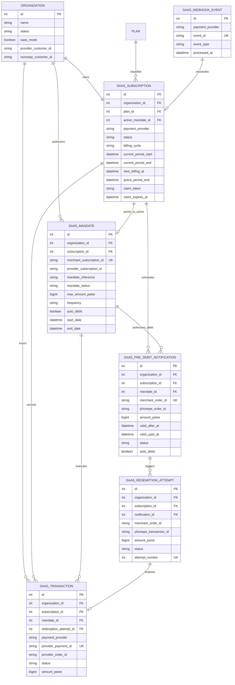
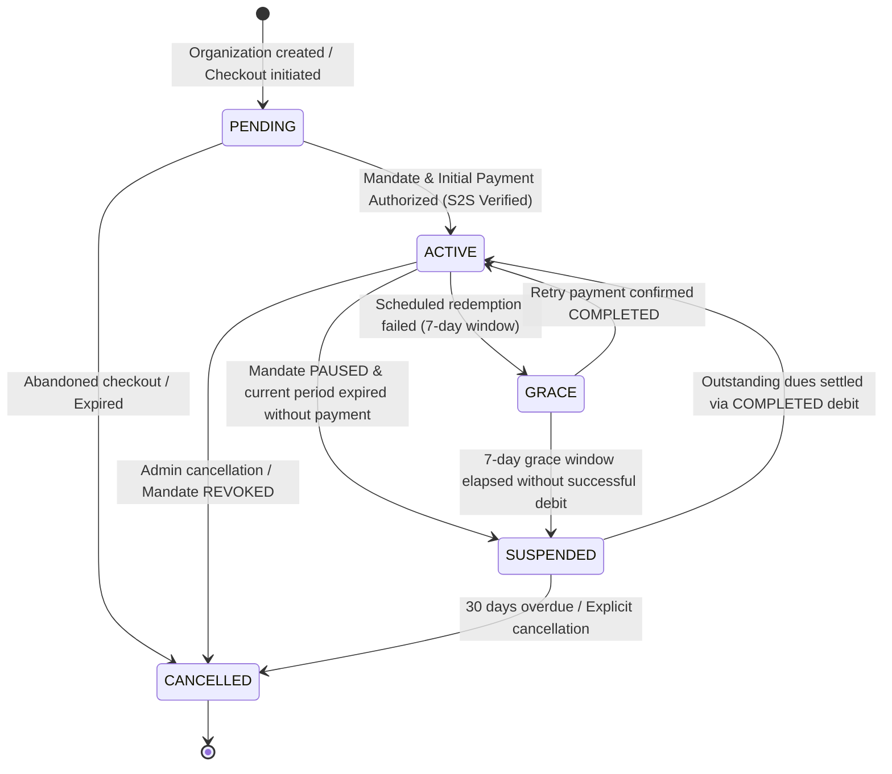
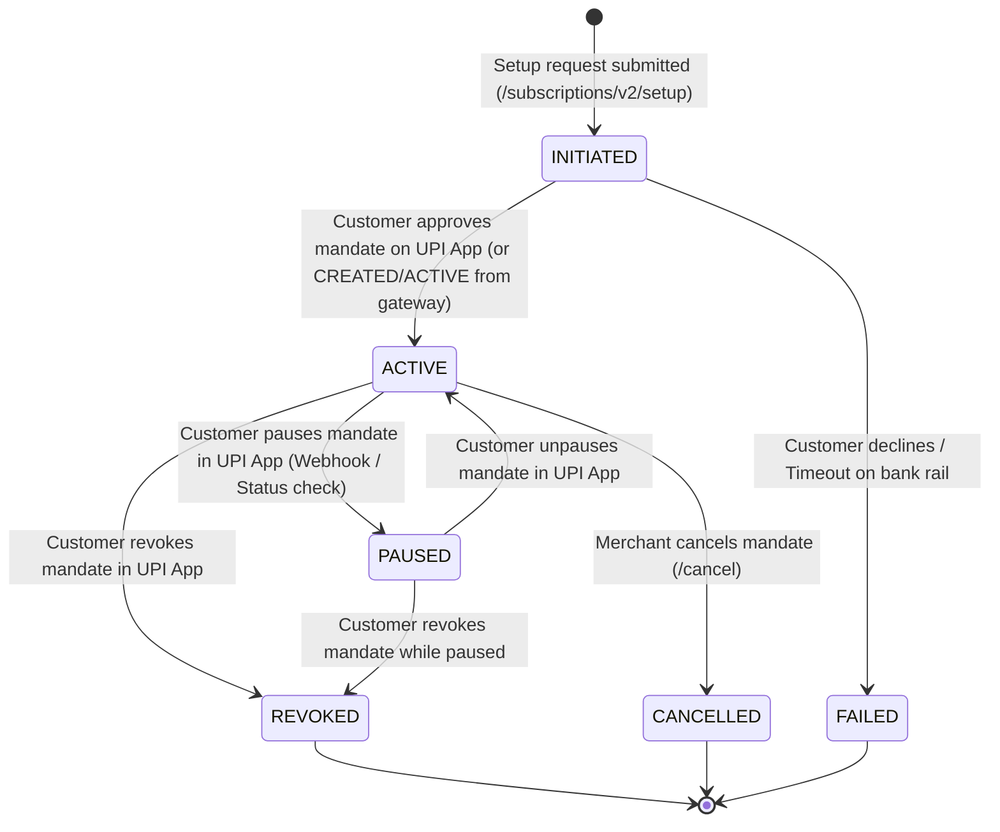

# PhonePe AutoPay V2: Database & Subscription Lifecycle Architecture

**Document Version:** 1.1.0 (Architecture Review Revision)  
**Phase:** 3 — Architecture Analysis & Design  
**Target Repository:** `Glass-Entials/CRM-Glass-Entials`  
**Status:** REVISED & PROPOSED (Pending Review & Explicit Approval)  
**Author:** AI Architecture Team  
**Date:** November 2026  

---

## Executive Summary

This document specifies the target **Database Architecture, Subscription Lifecycle Engine, Concurrency Safeguards, and Webhook Architecture** for migrating GlassEntials CRM from legacy payment integrations to **PhonePe AutoPay V2 (Standard Checkout Subscriptions)**.

### Strict Architectural Boundaries:
1. **Design Only**: No application code, database migrations, model modifications, or route modifications are executed during Phase 3.
2. **Zero Regression for Razorpay**: All existing Razorpay database fields, migration histories, payment logs, and configuration variables remain **100% untouched and preserved**.
3. **Preservation of PhonePe V3**: The existing `PhonePeProvider` (legacy V3 X-VERIFY checksum based) remains operational as a fallback; the new V2 architecture introduces a modular, parallel provider (`PhonePeAutoPayV2Provider`) powered by the Phase 1 OAuth Client (`PhonePeOAuthClient`) and Phase 2 API Client (`PhonePeAutoPayClient`).

---

## Table of Contents

1. [Existing Architecture Audit (Corrected)](#1-existing-architecture-audit-corrected)
2. [Current Billing Flow & Deficiencies](#2-current-billing-flow--deficiencies)
3. [Proposed System Architecture](#3-proposed-system-architecture)
4. [Database Schema Design & Single Sources of Truth](#4-database-schema-design--single-sources-of-truth)
5. [Entity Relationship Diagram (Updated)](#5-entity-relationship-diagram-updated)
6. [Subscription & Mandate Lifecycle State Machines (Corrected)](#6-subscription--mandate-lifecycle-state-machines-corrected)
7. [Payment & Redemption Sequence Diagrams](#7-payment--redemption-sequence-diagrams)
8. [Webhook Processing Architecture & Verification Contract](#8-webhook-processing-architecture--verification-contract)
9. [Financial Safety, Idempotency & Concurrency Strategy](#9-financial-safety-idempotency--concurrency-strategy)
10. [API Integration Mapping (Documented PhonePe V2 States)](#10-api-integration-mapping-documented-phonepe-v2-states)
11. [Failure Handling, Timeouts & Reconciliation Engine](#11-failure-handling-timeouts--reconciliation-engine)
12. [Database Migration Strategy & Historical Constraint Compatibility](#12-database-migration-strategy--historical-constraint-compatibility)
13. [Tenant Isolation & Security Architecture](#13-tenant-isolation--security-architecture)
14. [Testing Strategy](#14-testing-strategy)
15. [Implementation Roadmap](#15-implementation-roadmap)
16. [Open Questions, Gateway Dependencies & Risks](#16-open-questions-gateway-dependencies--risks)
17. [Architecture Review Corrections — Version 1.1](#17-architecture-review-corrections--version-11)

---

## 1. Existing Architecture Audit (Corrected)

The GlassEntials CRM SaaS billing module is built on **Flask + SQLAlchemy + MySQL 8.0**. Below is the verified audit of existing repository components:

### 1.1 Data Models (`model.py`)
- **`Organization` (`organization`)**:
  - Acts as the multi-tenant root entity.
  - Fields include `status` (`OrganizationStatus`: `PENDING`, `ACTIVE`, `GRACE`, `SUSPENDED`, `ARCHIVED`, `CANCELLED`), `saas_mode` (boolean), `provider_customer_id` (VARCHAR 100), and `razorpay_customer_id` (VARCHAR 100).
  - Relationships: 1-to-1 with `SaaSSubscription`, 1-to-many with `SaaSTransaction`.
- **`Plan` (`plan`)**:
  - Defines SaaS tiers (`Basic`, `Professional`, `Enterprise`).
  - Fields: `monthly_price_paise` (BIGINT), `yearly_price_paise` (BIGINT), `features_json`, legacy `razorpay_monthly_plan_id`, `razorpay_yearly_plan_id`.
- **`SaaSSubscription` (`saas_subscription`)**:
  - Tracks organization subscriptions. Unique constraint on `organization_id` (1 subscription per org).
  - Fields: `payment_provider` (`'phonepe'`, `'razorpay'`), `provider_subscription_id` (VARCHAR 100, UNIQUE, indexed), `provider_order_id`, `provider_transaction_id`, `provider_customer_reference`, `mandate_reference` (holds UPI UMN), `amount_paise`, `currency`, `status` (`SaaSSubscriptionStatus`), `billing_cycle` (`MONTHLY`, `YEARLY`).
  - Dates: `current_period_start`, `current_period_end`, `next_billing_at`, `grace_period_end`, `cancelled_at`.
  - Legacy fields: `razorpay_subscription_id` (UNIQUE), `razorpay_plan_id`.
- **`SaaSTransaction` (`saas_transaction`)**:
  - Immutable ledger of payment attempts and successes.
  - Fields: `organization_id`, `subscription_id`, `payment_provider`, `provider_payment_id` (VARCHAR 100, UNIQUE, indexed), `provider_order_id`, `provider_transaction_id`, `provider_subscription_id`, `amount_paise`, `currency`, `status` (`SaaSTransactionStatus`: `SUCCESS`, `FAILED`, `PENDING`, `REFUNDED`), `payment_method`, `failure_reason`.
  - Legacy fields: `razorpay_payment_id` (UNIQUE), `razorpay_invoice_id`, `razorpay_subscription_id`, `razorpay_event_id` (UNIQUE).
- **`SaaSWebhookEvent` (`saas_webhook_event`)**:
  - Idempotency store for inbound webhooks.
  - Fields: `id`, `payment_provider`, `event_id` (VARCHAR 100, UNIQUE, indexed), `event_type`, `processed_at`, `payload_summary`.

### 1.2 Domain Services (`services/billing/`)
- **`SubscriptionService`**: Coordinates mandate initiation, activation, suspension, cancellation, and grace period entry.
- **`TransactionService`**: Records transactions, provides idempotency lookups on `provider_payment_id`.
- **`RenewalService`**: Handles pre-debit notifications and recurring redemptions. (Note: currently relies on a temporary in-memory timestamp bump `sub.next_billing_at = now + 30m` rather than a database-level atomic claim).
- **`BillingService` (`services/billing/billing_service.py`)**:
  - **Correction**: `BillingService` currently registers **only `PhonePeProvider`**. There is **no operational `RazorpayProvider` class registered** in the factory; requesting any provider other than `'phonepe'` raises `ValueError("Unsupported payment provider")`. Razorpay exists strictly as a historical schema and configuration artifact that must be preserved.

### 1.3 HTTP Endpoints (`routes/saas.py`)
- `GET /saas/checkout`: Renders checkout page for organizations with `OrganizationStatus.PENDING`.
- `POST /saas/api/create-subscription`: Initiates mandate creation and returns the redirect URL.
- `GET / POST /saas/phonepe-callback`: Browser return URL from PhonePe checkout. Executes S2S transaction inquiry before activating organization.
- `POST /saas/api/verify-payment`: Client-side verification endpoint.
- `POST /saas/phonepe-webhook`: Receives asynchronous S2S notifications. Exempt from CSRF (`csrf.exempt(saas_bp)` in `app.py`).
- `POST /saas/api/process-renewals`: Cron trigger endpoint protected by `RENEWAL_CRON_SECRET` using `hmac.compare_digest`.

---

## 2. Current Billing Flow & Deficiencies

### 2.1 Current V3 Execution Flow
```
[Customer Checkout]
       │
       ▼
SubscriptionService.initiate_subscription()
       │
       ▼
PhonePeProvider.create_subscription_mandate() (/v3/recurring/subscription/create)
       │
       ▼
Redirect to PhonePe Standard Checkout Page
       │
       ▼
Customer approves UPI Mandate in UPI App (PhonePe, GPay, etc.)
       │
       ▼
Browser redirected to /saas/phonepe-callback
       │
       ▼
Authoritative S2S Check: PhonePeProvider.check_transaction_status()
       │
       ▼
SubscriptionService.activate_subscription() -> Org ACTIVE, SaaSSubscription ACTIVE
```

### 2.2 Deficiencies Discovered in Current Implementation

| Area | Current Implementation Defect | Consequence in Production |
|---|---|---|
| **Mandate vs Subscription Coupling** | `SaaSSubscription` has a 1-to-1 relationship with `Organization` and directly holds `provider_subscription_id` with a UNIQUE constraint. | If a customer's mandate fails or is cancelled, and they try to set up a new mandate, the unique constraint conflicts with past history or destroys historical mandate tracking. |
| **Notification Persistence Gap** | `RenewalService.process_upcoming_notifications` calls PhonePe Notify, but **does not record the resulting notification in the database**. | In V2, `redeem()` **requires the exact `merchantOrderId`** generated during `notify()`. Without storing the notification order in the DB, `redeem()` has no reliable state to read from. |
| **AutoDebit Flag Ignored** | Current code assumes all redemptions must be manually executed by `RenewalService`. | In PhonePe AutoPay V2, when `autoDebit: true`, calling `redeem()` triggers an error (`MANDATE_ALREADY_PROCESSING` or duplicate debit). The system must respect whether the mandate is configured for automated gateway debit or merchant-initiated debit. |
| **Lack of Mandate History** | Customer mandate pause/resume events overwrite `SaaSSubscription.status`. | If a customer pauses their mandate on their UPI app, CRM cannot distinguish between "Subscription suspended for non-payment" and "Mandate paused temporarily by customer in PhonePe app". |
| **Concurrency Lock Limitation** | `sub.next_billing_at = now + 30m` is used as an in-flight lock. | If two workers execute concurrently, both can read the same rows before the update occurs unless database row-level locking (`SELECT FOR UPDATE`) or a dedicated atomic claim token is used. |

---

## 3. Proposed System Architecture

To support PhonePe AutoPay V2 cleanly without breaking Razorpay or legacy PhonePe V3, we adopt a **modular provider architecture**:

```
                              ┌─────────────────────────────────────────────────────────┐
                              │                    Flask Routes Layer                   │
                              │                    (routes/saas.py)                     │
                              └────────────────────────────┬────────────────────────────┘
                                                           │
                                                           ▼
                              ┌─────────────────────────────────────────────────────────┐
                              │                  Billing Service Factory                │
                              │            (services/billing/billing_service.py)         │
                              └──────┬─────────────────────┬─────────────────────┬──────┘
                                     │                     │                     │
                     provider="razorpay"          provider="phonepe"    provider="phonepe_v2"
                                     │                     │                     │
                                     ▼                     ▼                     ▼
                       ┌──────────────────────┐  ┌───────────────────┐  ┌───────────────────────────┐
                       │ Razorpay Integration │  │ PhonePeProvider   │  │ PhonePeAutoPayV2Provider  │
                       │   (Legacy / Frozen)  │  │ (Legacy V3 Check) │  │ (AutoPay V2 Standard Flow)│
                       └──────────────────────┘  └───────────────────┘  └─────────────┬─────────────┘
                                                                                      │
                                                                       ┌──────────────┴──────────────┐
                                                                       ▼                             ▼
                                                        ┌─────────────────────────────┐ ┌───────────────────────────┐
                                                        │     PhonePeOAuthClient      │ │   PhonePeAutoPayClient    │
                                                        │  (Phase 1 Token Management) │ │  (Phase 2 REST Endpoints) │
                                                        └─────────────────────────────┘ └───────────────────────────┘
```

---

## 4. Database Schema Design & Single Sources of Truth

### 4.1 Strict Single Source of Truth (SSOT) Definition

To avoid data desynchronization and race conditions, each domain attribute is owned by **exactly one** entity:

1. **`saas_mandate` is the sole Single Source of Truth for Banking / Gateway Mandate State**:
   - `mandate_status`: The authoritative state of the UPI AutoPay mandate (`INITIATED`, `ACTIVE`, `PAUSED`, `REVOKED`, `COMPLETED`, `FAILED`).
   - `auto_debit`: The authoritative boolean flag indicating whether PhonePe automatically executes recurring debits for this mandate.
   - `mandate_reference`: The NPCI Unique Mandate Number (UMN).
   - `max_amount_paise`, `frequency`, `start_date`, `end_date`.
2. **`saas_subscription` is the sole Single Source of Truth for SaaS Application Entitlement**:
   - `status`: Customer entitlement state (`PENDING`, `ACTIVE`, `GRACE`, `SUSPENDED`, `CANCELLED`).
   - `current_period_start`, `current_period_end`, `next_billing_at`, `grace_period_end`.
   - `active_mandate_id`: Internal foreign key (`INT`, nullable) referencing `saas_mandate.id`.
   - **No Duplicate Columns**: `auto_debit` and `mandate_status` are **NOT** added to `saas_subscription`. The application reads them via `subscription.active_mandate.auto_debit` and `subscription.active_mandate.mandate_status`.

---

### 4.2 Table Definitions

#### A. Extended Table: `saas_subscription`
Adds only foreign-key linkage to the active mandate and worker claim attributes.

```sql
ALTER TABLE saas_subscription
    ADD COLUMN active_mandate_id INT NULL COMMENT 'FK to saas_mandate.id representing active mandate',
    ADD COLUMN claim_token VARCHAR(64) NULL COMMENT 'Worker lease UUID for atomic scheduler execution',
    ADD COLUMN claim_expires_at DATETIME NULL COMMENT 'Expiry timestamp of worker claim lease',
    ADD CONSTRAINT fk_saas_sub_active_mandate FOREIGN KEY (active_mandate_id) REFERENCES saas_mandate(id) ON DELETE SET NULL,
    ADD INDEX ix_saas_sub_claim (claim_token, claim_expires_at);
```

#### B. New Table: `saas_mandate`
Maintains a complete audit history of all UPI AutoPay mandates ever created for an organization. Multiple mandates coexist across an organization's lifetime without unique-constraint collisions.

```sql
CREATE TABLE saas_mandate (
    id INT AUTO_INCREMENT PRIMARY KEY,
    organization_id INT NOT NULL,
    subscription_id INT NOT NULL,
    payment_provider VARCHAR(50) NOT NULL DEFAULT 'phonepe_v2',
    merchant_subscription_id VARCHAR(100) NOT NULL,
    provider_subscription_id VARCHAR(100) NULL,
    mandate_reference VARCHAR(100) NULL COMMENT 'NPCI Unique Mandate Number (UMN)',
    mandate_status VARCHAR(50) NOT NULL DEFAULT 'INITIATED' COMMENT 'INITIATED, ACTIVE, PAUSED, REVOKED, COMPLETED, FAILED',
    auth_workflow_type VARCHAR(50) NOT NULL DEFAULT 'TRANSACTION',
    amount_type VARCHAR(20) NOT NULL DEFAULT 'VARIABLE',
    max_amount_paise BIGINT NOT NULL,
    frequency VARCHAR(20) NOT NULL,
    auto_debit BOOLEAN NOT NULL DEFAULT FALSE,
    start_date DATETIME NULL,
    end_date DATETIME NULL,
    created_at DATETIME NOT NULL DEFAULT CURRENT_TIMESTAMP,
    updated_at DATETIME NOT NULL DEFAULT CURRENT_TIMESTAMP ON UPDATE CURRENT_TIMESTAMP,
    CONSTRAINT fk_saas_mandate_org FOREIGN KEY (organization_id) REFERENCES organization(id) ON DELETE CASCADE,
    CONSTRAINT fk_saas_mandate_sub FOREIGN KEY (subscription_id) REFERENCES saas_subscription(id) ON DELETE CASCADE,
    CONSTRAINT uq_saas_mandate_merchant_sub UNIQUE (organization_id, merchant_subscription_id),
    INDEX ix_saas_mandate_status (mandate_status),
    INDEX ix_saas_mandate_provider_sub (provider_subscription_id)
) ENGINE=InnoDB DEFAULT CHARSET=utf8mb4;
```

#### C. New Table: `saas_pre_debit_notification`
Stores pre-debit notifications (PDN) required by RBI regulations (sent 24–48 hours prior to debit). Provides the required `merchantOrderId` lookup for Phase 2 `redeem()` execution.

```sql
CREATE TABLE saas_pre_debit_notification (
    id INT AUTO_INCREMENT PRIMARY KEY,
    organization_id INT NOT NULL,
    subscription_id INT NOT NULL,
    mandate_id INT NOT NULL,
    merchant_order_id VARCHAR(100) NOT NULL,
    phonepe_order_id VARCHAR(100) NULL,
    amount_paise BIGINT NOT NULL,
    status VARCHAR(50) NOT NULL DEFAULT 'PENDING' COMMENT 'PENDING, COMPLETED, FAILED, EXPIRED, CONSUMED',
    auto_debit BOOLEAN NOT NULL DEFAULT FALSE,
    valid_after_at DATETIME NULL COMMENT 'Authoritative PhonePe timestamp after which debit is permitted',
    valid_upto_at DATETIME NULL COMMENT 'Authoritative PhonePe timestamp until which debit is permitted',
    error_code VARCHAR(100) NULL,
    error_message TEXT NULL,
    raw_response_json JSON NULL,
    created_at DATETIME NOT NULL DEFAULT CURRENT_TIMESTAMP,
    updated_at DATETIME NOT NULL DEFAULT CURRENT_TIMESTAMP ON UPDATE CURRENT_TIMESTAMP,
    CONSTRAINT fk_saas_pdn_org FOREIGN KEY (organization_id) REFERENCES organization(id) ON DELETE CASCADE,
    CONSTRAINT fk_saas_pdn_sub FOREIGN KEY (subscription_id) REFERENCES saas_subscription(id) ON DELETE CASCADE,
    CONSTRAINT fk_saas_pdn_mandate FOREIGN KEY (mandate_id) REFERENCES saas_mandate(id) ON DELETE CASCADE,
    CONSTRAINT uq_saas_pdn_order UNIQUE (organization_id, merchant_order_id),
    INDEX ix_saas_pdn_status (status),
    INDEX ix_saas_pdn_validity (valid_after_at, valid_upto_at)
) ENGINE=InnoDB DEFAULT CHARSET=utf8mb4;
```

#### D. New Table: `saas_redemption_attempt`
Tracks individual debit attempts against an accepted pre-debit notification. Ensures zero duplicate debits and enables safe recovery after network timeouts.

```sql
CREATE TABLE saas_redemption_attempt (
    id INT AUTO_INCREMENT PRIMARY KEY,
    organization_id INT NOT NULL,
    subscription_id INT NOT NULL,
    notification_id INT NOT NULL,
    merchant_order_id VARCHAR(100) NOT NULL,
    phonepe_transaction_id VARCHAR(100) NULL,
    amount_paise BIGINT NOT NULL,
    status VARCHAR(50) NOT NULL DEFAULT 'INITIATED' COMMENT 'INITIATED, PENDING_RECONCILIATION, COMPLETED, FAILED',
    attempt_number INT NOT NULL DEFAULT 1,
    failure_reason TEXT NULL,
    raw_response_json JSON NULL,
    created_at DATETIME NOT NULL DEFAULT CURRENT_TIMESTAMP,
    updated_at DATETIME NOT NULL DEFAULT CURRENT_TIMESTAMP ON UPDATE CURRENT_TIMESTAMP,
    CONSTRAINT fk_saas_redemption_org FOREIGN KEY (organization_id) REFERENCES organization(id) ON DELETE CASCADE,
    CONSTRAINT fk_saas_redemption_sub FOREIGN KEY (subscription_id) REFERENCES saas_subscription(id) ON DELETE CASCADE,
    CONSTRAINT fk_saas_redemption_pdn FOREIGN KEY (notification_id) REFERENCES saas_pre_debit_notification(id) ON DELETE CASCADE,
    CONSTRAINT uq_saas_redemption_attempt UNIQUE (organization_id, merchant_order_id, attempt_number),
    INDEX ix_saas_redemption_status (status)
) ENGINE=InnoDB DEFAULT CHARSET=utf8mb4;
```

#### E. Extended Table: `saas_transaction`
```sql
ALTER TABLE saas_transaction
    ADD COLUMN mandate_id INT NULL,
    ADD COLUMN redemption_attempt_id INT NULL,
    ADD CONSTRAINT fk_saas_tx_mandate FOREIGN KEY (mandate_id) REFERENCES saas_mandate(id) ON DELETE SET NULL,
    ADD CONSTRAINT fk_saas_tx_redemption FOREIGN KEY (redemption_attempt_id) REFERENCES saas_redemption_attempt(id) ON DELETE SET NULL;
```

---

## 5. Entity Relationship Diagram (Updated)



---

## 6. Subscription & Mandate Lifecycle State Machines (Corrected)

### 6.1 State Machine 1: `SaaSSubscriptionStatus` (CRM Billing Entitlement)
Tracks whether the tenant has access to the CRM features.



### 6.2 State Machine 2: `MandateStatus` (Banking / Rail State)
Tracks the status of the customer's mandate registered with NPCI / PhonePe.



### 6.3 State Transition Rules

1. **Customer pauses mandate in UPI app**:
   - `saas_mandate.mandate_status = 'PAUSED'`.
   - If `current_period_end > NOW()` (paid up): `saas_subscription.status` remains `ACTIVE`. User receives warning: *"Mandate paused on UPI app. Upcoming renewal will fail unless unpaused."*
   - When renewal arrives (`NOW() >= current_period_end`): Mandate cannot be debited. Subscription enters `GRACE` (7 days). If still paused after grace period, transitions to `SUSPENDED`.
2. **Customer unpauses mandate in UPI app**:
   - `saas_mandate.mandate_status = 'ACTIVE'`.
   - **Do NOT automatically reactivate subscription if dues are unpaid**:
     - If subscription is `SUSPENDED` with unpaid dues: Subscription remains `SUSPENDED` until a settlement debit is executed and reports `COMPLETED`.
     - If subscription is still within a paid period: Entitlement remains `ACTIVE`.
3. **Mandate revoked / cancelled by customer**:
   - `saas_mandate.mandate_status = 'REVOKED'`.
   - `saas_subscription.active_mandate_id = NULL`.
   - If paid up: Remains `ACTIVE` until `current_period_end`.
   - If period has expired: Transitions to `CANCELLED`. Customer must initiate a new mandate to reactivate.
4. **Customer creates a replacement mandate**:
   - Inserts a new row in `saas_mandate`.
   - Sets `saas_subscription.active_mandate_id = new_mandate.id`.
   - Upon initial payment confirmation, subscription transitions to `ACTIVE`.

---

## 7. Payment & Redemption Sequence Diagrams

*(Sequence flows follow the Standard Checkout redirect, 24–48h notification, and execution mechanisms as established in Sections 7.1–7.3 of Version 1.0).*

---

## 8. Webhook Processing Architecture & Verification Contract

### 8.1 Confirmed vs Unverified Webhook Specifications
- **Confirmed**:
  - Webhooks arrive via HTTP POST at `/saas/phonepe-webhook`.
  - Must be processed idempotently using `saas_webhook_event`.
  - Must never block or throw unhandled 500s; unauthenticated requests receive 401.
- **Merchant Profile Dependencies**:
  - PhonePe supports multiple signature schemes across merchant accounts (SHA256 X-VERIFY checksum, Basic Auth username/password, or O-Bearer token).
- **Core Security Rule: Webhooks as Hints, S2S as Truth**:
  - Inbound webhooks must be treated as **asynchronous hints**.
  - **Before marking any mandate `ACTIVE` or recording a payment `SUCCESS`, CRM must execute an authoritative Server-to-Server status check**:
    - Mandate setup: `client.get_subscription_status(merchantSubscriptionId)`.
    - Payment/Redemption: `client.get_order_status(merchantOrderId)`.
  - This shields the application from spoofed or unverified webhook payloads.

---

## 9. Financial Safety, Idempotency & Concurrency Strategy

### 9.1 Double-Debit Prevention Mechanics
1. **Deterministic Identifiers**:
   - Notification: `NOTIFY_{org_id}_{sub_id}_{cycle_epoch_tag}`.
   - Redemption: Reuses the identical `merchantOrderId` from the accepted notification.
2. **Database Constraints**:
   - `UNIQUE (organization_id, merchant_order_id)` on `saas_pre_debit_notification`.
   - `UNIQUE (organization_id, merchant_order_id, attempt_number)` on `saas_redemption_attempt`.
3. **Strict Separation of autoDebit Modes**:
   - If `auto_debit == True` on the mandate, CRM **never calls `redeem()`**. It only queries `get_order_status()`.

### 9.2 Atomic Worker Claim & Lease Recovery
To prevent multiple background workers from claiming the same due subscription:

```sql
-- Atomic claim query executed by renewal scheduler worker
UPDATE saas_subscription
SET claim_token = :worker_uuid,
    claim_expires_at = NOW() + INTERVAL 15 MINUTE
WHERE payment_provider = 'phonepe_v2'
  AND status IN ('active', 'grace')
  AND next_billing_at <= NOW()
  AND (claim_token IS NULL OR claim_expires_at < NOW())
LIMIT 50;
```
Each worker queries `WHERE claim_token = :worker_uuid`. Once processing is finished, `claim_token` is set to `NULL`. If a worker crashes, the lease expires after 15 minutes, allowing safe recovery.

---

## 10. API Integration Mapping (Documented PhonePe V2 States)

| CRM Operation | Phase 2 Client Method | Endpoint / HTTP Verb | Documented PhonePe V2 Statuses | Target CRM Action |
|---|---|---|---|---|
| **Mandate Setup** | `setup_subscription()` | `POST /subscriptions/v2/setup` | `200 OK`, `redirectInfo.url` | Insert `SaaSMandate(INITIATED)`, redirect user |
| **Mandate Status Inquiry** | `get_subscription_status()` | `GET /subscriptions/v2/{id}/status` | `CREATED`, `ACTIVE`, `PAUSED`, `REVOKED`, `COMPLETED` | Map directly to `saas_mandate.mandate_status` |
| **Pre-Debit Notification** | `notify_redemption()` | `POST /subscriptions/v2/notify` | `200 OK`, `validAfter`, `validUpto` | Insert `SaasPreDebitNotification(status="COMPLETED")`, persist validity timestamps |
| **Order Status Inquiry** | `get_order_status()` | `GET /checkout/v2/order/{id}/status` | `COMPLETED`, `PENDING`, `FAILED` | Authoritative check for setup and redemption orders |
| **Recurring Debit** | `redeem()` | `POST /subscriptions/v2/redeem` | `COMPLETED`, `PENDING`, `FAILED` | Handle 3-state outcome; update `SaasRedemptionAttempt` |
| **Cancel Mandate** | `cancel_subscription()` | `POST /checkout/v2/subscriptions/{id}/cancel` | `HTTP 204 No Content` | Confirm via `get_subscription_status()` -> `CANCELLED` |

---

## 11. Failure Handling, Timeouts & Reconciliation Engine

### 11.1 The 6 Reconciliation Outcomes
When checking the status of an in-flight or timed-out redemption request:

1. **Definitive `COMPLETED`**:
   Authoritative debit confirmed. Advance `current_period_end` and `next_billing_at`, clear `grace_period_end`, record `SaaSTransaction(SUCCESS)`.
2. **Definitive `FAILED`** (Terminal gateway failure code):
   Authoritative debit failure. Mark attempt as `FAILED`. Enter `GRACE` period. Safe to reschedule retry in 24h if within 7-day grace window.
3. **`PENDING`**:
   In-flight on banking/NPCI rails. **DO NOT RETRY DEBIT**. Reschedule status inquiry in 1 hour.
4. **Network Timeout / Connection Error**:
   Ambiguous. Mark attempt as `PENDING_RECONCILIATION`. Block any new debit attempts for this cycle. Schedule inquiry via `get_order_status()`.
5. **`NOT_FOUND` within initial window (< 4 hours)**:
   Could be eventual-consistency synchronization delay on PhonePe gateway clusters. Treat as `AMBIGUOUS_NOT_FOUND`. **DO NOT execute another debit.** Reschedule inquiry with exponential backoff.
6. **`NOT_FOUND` after terminal window (> 24 hours)**:
   Authoritatively confirmed that gateway never received the order. Mark attempt as `DROPPED`. Safe to re-notify or retry only after terminal confirmation.

---

## 12. Database Migration Strategy & Historical Constraint Compatibility

### 12.1 Backward Compatibility Invariants
- Existing subscriptions with `payment_provider = 'razorpay'` remain governed by legacy rules.
- Existing migrations are not touched; a new migration will be created in Phase 4.
- All new columns are `NULL` or have safe server defaults (`0`, `FALSE`, `'INITIATED'`).

### 12.2 Handling the `SaaSSubscription.provider_subscription_id` Unique Constraint
- In migration `b7e9a1c2d3f4`, `saas_subscription.provider_subscription_id` has a unique constraint.
- Under PhonePe AutoPay V2:
  - Canonical mandate identifiers belong in `saas_mandate` (`merchant_subscription_id` and `provider_subscription_id`).
  - `saas_subscription.active_mandate_id` holds the foreign key to the active mandate.
  - On `saas_subscription`, `provider_subscription_id` is updated to point to the current active mandate's ID for backward compatibility with existing getter properties, but unique constraint collisions are eliminated because inactive/historical mandates reside in `saas_mandate`.

---

## 13. Tenant Isolation & Security Architecture

1. **Composite Tenant Ownership Constraints**:
   - `saas_mandate`: `UNIQUE (organization_id, merchant_subscription_id)`.
   - `saas_pre_debit_notification`: `UNIQUE (organization_id, merchant_order_id)`.
   - `saas_redemption_attempt`: `UNIQUE (organization_id, merchant_order_id, attempt_number)`.
   - Foreign keys enforce cascading isolation; domain service queries strictly scope by `organization_id = current_user.organization_id`.
2. **Secret Hygiene**: Access tokens, Client Secrets, and webhook authorization headers are never logged or stored in application database records.
3. **Endpoint CSRF Exemption**: `/saas/phonepe-webhook` is CSRF-exempt because S2S servers cannot obtain browser CSRF cookies; protected cryptographically via signature verification.

---

## 14. Testing Strategy

Prior to production activation, implementations must pass:
1. **Unit Tests (100% Mocked)**:
   - State transition validations for `SaaSSubscriptionStatus` and `MandateStatus`.
   - Idempotency checks: duplicate webhooks, duplicate notifications, duplicate claims.
   - Timeout recovery: simulated network drops during `redeem()`.
2. **Concurrency Tests**:
   - 10 simulated parallel workers executing `process_due_renewals()` on the same pool of due subscriptions; assertion: zero duplicate debits.
3. **Regression Tests**:
   - All 44 tests in `test_phonepe_oauth.py` pass.
   - All 30 tests in `test_phonepe_autopay_client.py` pass.
   - All 17 tests in `test_phonepe_billing.py` pass.

---

## 15. Implementation Roadmap

The implementation following this architecture design is divided into sequential phases:

```
┌────────────────────────────────────────────────────────┐
│ Phase 3: Architecture & Design Specification (CURRENT) │
└──────────────────────────┬─────────────────────────────┘
                           │
                           ▼
┌────────────────────────────────────────────────────────┐
│ Phase 4: Database Schema Migration & Model Definition  │
│ - Create Alembic migration script                      │
│ - Implement SaaSMandate, SaasPreDebitNotification, etc.│
└──────────────────────────┬─────────────────────────────┘
                           │
                           ▼
┌────────────────────────────────────────────────────────┐
│ Phase 5: PhonePeAutoPayV2Provider Implementation       │
│ - Implement PaymentProvider interface for V2           │
│ - Integrate Phase 1 OAuth and Phase 2 API Client       │
│ - Build Mandate, Notification, and Redemption services │
└──────────────────────────┬─────────────────────────────┘
                           │
                           ▼
┌────────────────────────────────────────────────────────┐
│ Phase 6: Webhook Processing & Scheduler Concurrency    │
│ - Upgrade /saas/phonepe-webhook for V2 payload schema  │
│ - Upgrade RenewalService with atomic claiming & recovery│
└──────────────────────────┬─────────────────────────────┘
                           │
                           ▼
┌────────────────────────────────────────────────────────┐
│ Phase 7: Comprehensive Verification & Staging Cutover  │
│ - Automated end-to-end integration test suite          │
│ - Switch BILLING_DEFAULT_PROVIDER="phonepe_v2"         │
└────────────────────────────────────────────────────────┘
```

---

## 16. Open Questions, Gateway Dependencies & Risks

1. **Merchant AutoDebit Mode**:
   - Does our approved PhonePe merchant account have `autoDebit: true` (gateway-managed debits) or `autoDebit: false` (merchant-triggered debits)?
   - *Design accommodation*: Supported cleanly via the `auto_debit` boolean flag on `saas_mandate`.
2. **Webhook Cryptographic Signature Format**:
   - Must verify whether merchant dashboard transmits webhooks with Basic auth, SHA256 X-VERIFY, or asymmetric public-key signatures.
3. **Production Sandbox Provisioning**:
   - The generic test MID `PGTESTPAYUAT` lacks AutoPay recurring provisioning; real sandbox testing requires the merchant's approved credentials.

---

## 17. Architecture Review Corrections — Version 1.1

This section details the specific issues identified in the architectural review and how Version 1.1 resolves them:

| Review Item | Issue in Version 1.0 | Architectural Resolution in Version 1.1 |
|---|---|---|
| **1. Single Sources of Truth (SSOT)** | Duplicated `auto_debit` and `mandate_status` on both `saas_subscription` and `saas_mandate`. | **Eliminated duplicate columns**. `saas_mandate` is the sole SSOT for banking/mandate states. `saas_subscription` is the sole SSOT for CRM entitlement (`status`). `saas_subscription.active_mandate_id` links to the active mandate. |
| **2. Unique Constraints & Resubscription** | `SaaSSubscription.provider_subscription_id` is unique, blocking multiple historical mandates per organization. | Historical mandates are moved to `saas_mandate`. Resubscription inserts a new `saas_mandate` row and updates `saas_subscription.active_mandate_id`. Unique constraints are scoped to `(organization_id, merchant_subscription_id)` on `saas_mandate`. |
| **3. PhonePe API Status Handling** | Used undocumented states like `NOTIFICATION_ACCEPTED` and assumed eligibility windows. | Replaced with documented PhonePe V2 states: Subscription (`CREATED`, `ACTIVE`, `PAUSED`, `REVOKED`, `COMPLETED`), Order (`COMPLETED`, `PENDING`, `FAILED`). Persist authoritative `validAfter` and `validUpto` timestamps. |
| **4. Timeout & Reconciliation Logic** | `NOT_FOUND` from gateway was treated as proof of debit failure, risking duplicate debits. | Defined **6 distinct reconciliation outcomes**. `NOT_FOUND` within 4 hours is treated as ambiguous lag; calling another debit is strictly blocked until authoritative terminal status is confirmed. |
| **5. Mandate & Subscription State Transitions** | Automatically assumed unpausing mandate reactivates subscription, ignoring unpaid dues. | Decoupled mandate unpause from subscription reactivation. Subscriptions with unpaid dues remain `SUSPENDED` until debt settlement debits report `COMPLETED`. |
| **6. Strengthened Tenant Isolation** | Proposed foreign keys did not guarantee cross-tenant isolation. | Added composite unique constraints `(organization_id, merchant_order_id)` and enforced `organization_id` filtering on all child relationships. |
| **7. Existing Architecture Audit Accuracy** | Implied Razorpay provider was active; described timestamp bump as atomic lock. | Corrected: `BillingService` currently registers only PhonePe. Razorpay is dormant and preserved. Added true database atomic lease claiming (`claim_token`, `claim_expires_at`). |
| **8. Financial Idempotency & Retries** | Ambiguous retry policy could conflict with double-debit prevention. | Retrying ambiguous or timed-out requests is strictly prohibited. Retries are allowed only for definitively `FAILED` outcomes, capped at 3 attempts within the 7-day grace window. |
| **9. Webhook Contract Verification** | Included unverified event names and signature assumptions. | Separated confirmed facts from dashboard-specific dependencies. Mandated that webhooks serve only as triggers, requiring authoritative S2S API verification before state changes. |

---

## Approvals & Sign-off

| Role | Name | Status | Date |
|---|---|---|---|
| Lead Architect | AI Architecture Team | Revised & Submitted (v1.1) | November 2026 |
| Engineering Lead | User / Reviewer | Pending Review | — |
