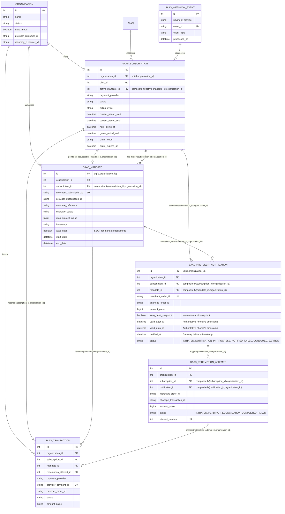
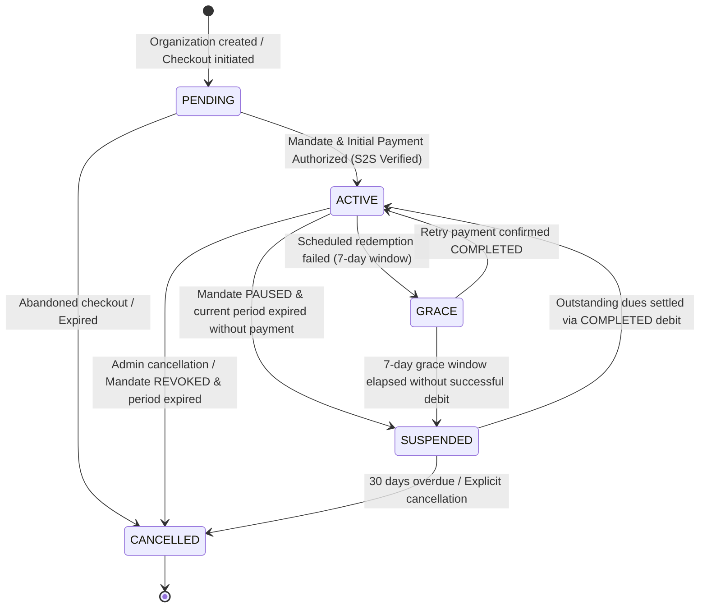
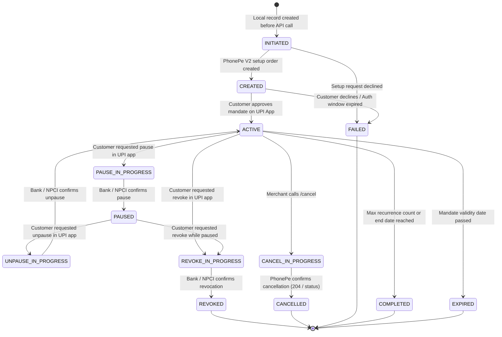
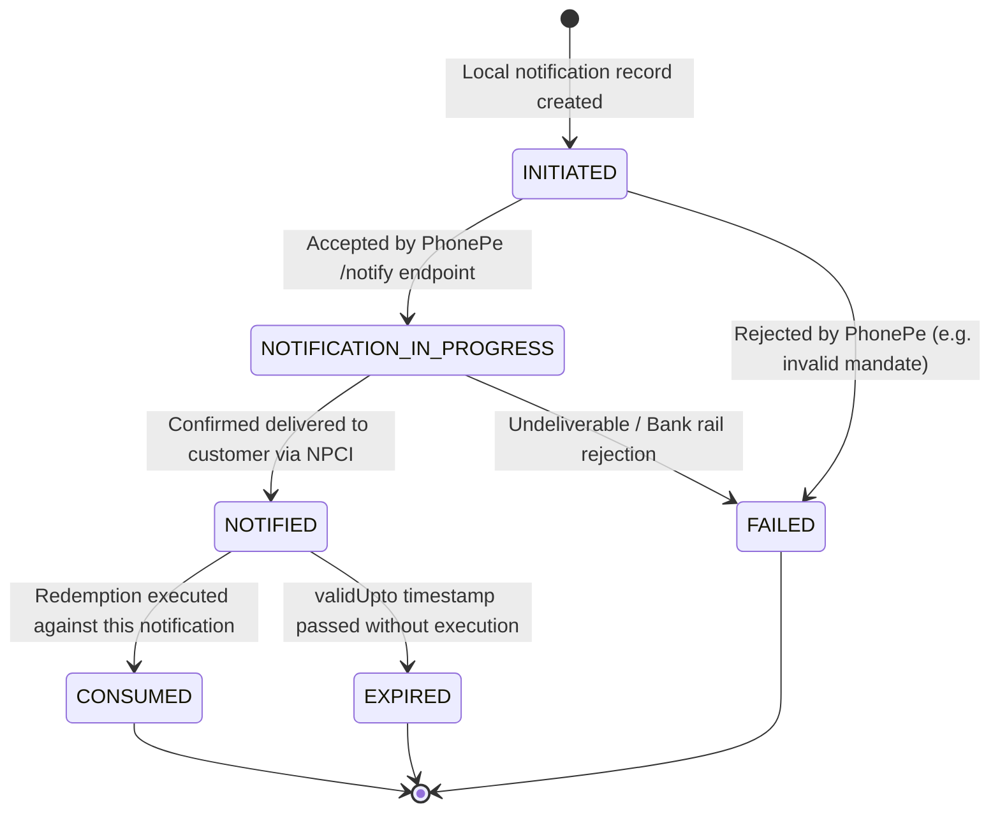
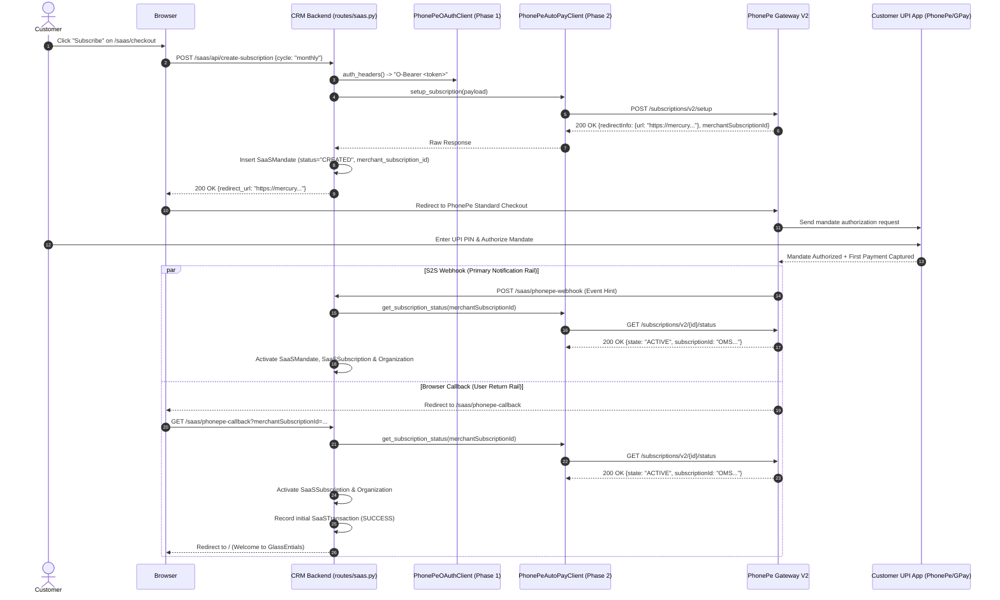
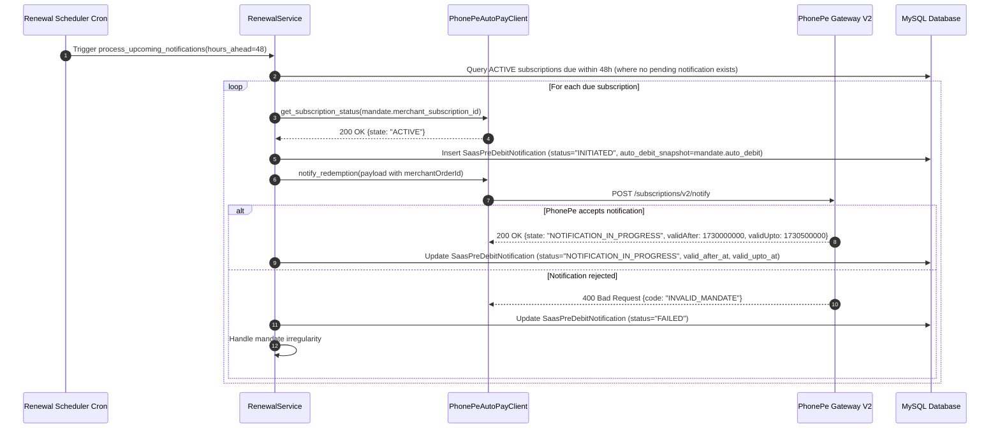

# PhonePe AutoPay V2: Database & Subscription Lifecycle Architecture

**Document Version:** 1.2.0 (Architecture Review Revision 2)  
**Phase:** 3 — Architecture Analysis & Design  
**Target Repository:** `Glass-Entials/CRM-Glass-Entials`  
**Status:** REVISED & PROPOSED (Pending Review & Explicit Approval)  
**Author:** AI Architecture Team  
**Date:** November 2026  

---

## Executive Summary

This document specifies the target **Database Architecture, Subscription Lifecycle Engine, Concurrency Safeguards, and Webhook Architecture** for migrating GlassEntials CRM from legacy payment integrations to **PhonePe AutoPay V2 (Standard Checkout Subscriptions)**.

### Strict Architectural Boundaries:
1. **Design Only**: No application code, database migrations, model modifications, or route modifications are executed during Phase 3.
2. **Zero Regression for Razorpay**: All existing Razorpay database fields, migration histories, payment logs, and configuration variables remain **100% untouched and preserved**.
3. **Preservation of PhonePe V3**: The existing `PhonePeProvider` (legacy V3 X-VERIFY checksum based) remains operational as a fallback; the new V2 architecture introduces a modular, parallel provider (`PhonePeAutoPayV2Provider`) powered by the Phase 1 OAuth Client (`PhonePeOAuthClient`) and Phase 2 API Client (`PhonePeAutoPayClient`).

---

## Table of Contents

1. [Existing Architecture Audit (Verified & Corrected)](#1-existing-architecture-audit-verified--corrected)
2. [Current Billing Flow & Deficiencies](#2-current-billing-flow--deficiencies)
3. [Proposed System Architecture](#3-proposed-system-architecture)
4. [Database Schema Design & Single Sources of Truth](#4-database-schema-design--single-sources-of-truth)
5. [Enforced Multi-Tenant Ownership via Composite Database Constraints](#5-enforced-multi-tenant-ownership-via-composite-database-constraints)
6. [Entity Relationship Diagram (Updated)](#6-entity-relationship-diagram-updated)
7. [Subscription, Mandate & Notification Lifecycle State Machines](#7-subscription-mandate--notification-lifecycle-state-machines)
8. [Payment & Redemption Sequence Diagrams](#8-payment--redemption-sequence-diagrams)
9. [Webhook Architecture & Verification Contract](#9-webhook-architecture--verification-contract)
10. [Financial Safety, Idempotency & Concurrency Strategy](#10-financial-safety-idempotency--concurrency-strategy)
11. [API Integration Mapping (Documented PhonePe V2 States)](#11-api-integration-mapping-documented-phonepe-v2-states)
12. [Failure Handling, Timeouts & Ambiguity Reconciliation Engine](#12-failure-handling-timeouts--ambiguity-reconciliation-engine)
13. [Database Migration Sequencing & Historical Compatibility](#13-database-migration-sequencing--historical-compatibility)
14. [Tenant Isolation & Security Architecture](#14-tenant-isolation--security-architecture)
15. [Testing Strategy](#15-testing-strategy)
16. [Implementation Roadmap](#16-implementation-roadmap)
17. [Open Questions, Gateway Dependencies & Risks](#17-open-questions-gateway-dependencies--risks)
18. [Architecture Review Corrections — Version 1.2](#18-architecture-review-corrections--version-12)

---

## 1. Existing Architecture Audit (Verified & Corrected)

The GlassEntials CRM SaaS billing module is built on **Flask + SQLAlchemy + MySQL 8.0**. Below is the verified audit of existing repository components:

### 1.1 Data Models (`model.py`)
- **`Organization` (`organization`)**:
  - Acts as the multi-tenant root entity.
  - Fields include `status` (`OrganizationStatus`: `PENDING`, `ACTIVE`, `GRACE`, `SUSPENDED`, `ARCHIVED`, `CANCELLED`), `saas_mode` (boolean), `provider_customer_id` (VARCHAR 100), and `razorpay_customer_id` (VARCHAR 100).
  - Relationships: 1-to-1 with `SaaSSubscription`, 1-to-many with `SaaSTransaction`.
- **`Plan` (`plan`)**:
  - Defines SaaS tiers (`Basic`, `Professional`, `Enterprise`).
  - Fields: `monthly_price_paise` (BIGINT), `yearly_price_paise` (BIGINT), `features_json`, legacy `razorpay_monthly_plan_id`, `razorpay_yearly_plan_id`.
- **`SaaSSubscription` (`saas_subscription`)**:
  - Tracks organization subscriptions. Unique constraint on `organization_id` (1 subscription per org).
  - Fields: `payment_provider` (`'phonepe'`, `'razorpay'`), `provider_subscription_id` (VARCHAR 100, UNIQUE, indexed), `provider_order_id`, `provider_transaction_id`, `provider_customer_reference`, `mandate_reference` (holds UPI UMN), `amount_paise`, `currency`, `status` (`SaaSSubscriptionStatus`), `billing_cycle` (`MONTHLY`, `YEARLY`).
  - Dates: `current_period_start`, `current_period_end`, `next_billing_at`, `grace_period_end`, `cancelled_at`.
  - Legacy fields: `razorpay_subscription_id` (UNIQUE), `razorpay_plan_id`.
- **`SaaSTransaction` (`saas_transaction`)**:
  - Immutable ledger of payment attempts and successes.
  - Fields: `organization_id`, `subscription_id`, `payment_provider`, `provider_payment_id` (VARCHAR 100, UNIQUE, indexed), `provider_order_id`, `provider_transaction_id`, `provider_subscription_id`, `amount_paise`, `currency`, `status` (`SaaSTransactionStatus`: `SUCCESS`, `FAILED`, `PENDING`, `REFUNDED`), `payment_method`, `failure_reason`.
  - Legacy fields: `razorpay_payment_id` (UNIQUE), `razorpay_invoice_id`, `razorpay_subscription_id`, `razorpay_event_id` (UNIQUE).
- **`SaaSWebhookEvent` (`saas_webhook_event`)**:
  - Idempotency store for inbound webhooks.
  - Fields: `id`, `payment_provider`, `event_id` (VARCHAR 100, UNIQUE, indexed), `event_type`, `processed_at`, `payload_summary`.

### 1.2 Domain Services (`services/billing/`)
- **`SubscriptionService`**: Coordinates mandate initiation, activation, suspension, cancellation, and grace period entry.
- **`TransactionService`**: Records transactions, provides idempotency lookups on `provider_payment_id`.
- **`RenewalService`**: Handles pre-debit notifications and recurring redemptions. (Note: currently relies on a temporary in-memory timestamp bump `sub.next_billing_at = now + 30m` rather than a database-level atomic claim).
- **`BillingService` (`services/billing/billing_service.py`)**:
  - **Correction**: `BillingService` currently registers **only `PhonePeProvider`**. There is **no operational `RazorpayProvider` class registered** in the factory; requesting any provider other than `'phonepe'` raises `ValueError("Unsupported payment provider")`. Razorpay exists strictly as a historical schema and configuration artifact that must be preserved.

### 1.3 HTTP Endpoints (`routes/saas.py`)
- `GET /saas/checkout`: Renders checkout page for organizations with `OrganizationStatus.PENDING`.
- `POST /saas/api/create-subscription`: Initiates mandate creation and returns the redirect URL.
- `GET / POST /saas/phonepe-callback`: Browser return URL from PhonePe checkout. Executes S2S transaction inquiry before activating organization.
- `POST /saas/api/verify-payment`: Client-side verification endpoint.
- `POST /saas/phonepe-webhook`: Receives asynchronous S2S notifications. Exempt from CSRF (`csrf.exempt(saas_bp)` in `app.py`).
- `POST /saas/api/process-renewals`: Cron trigger endpoint protected by `RENEWAL_CRON_SECRET` using `hmac.compare_digest`.

---

## 2. Current Billing Flow & Deficiencies

### 2.1 Current V3 Execution Flow
```
[Customer Checkout]
       │
       ▼
SubscriptionService.initiate_subscription()
       │
       ▼
PhonePeProvider.create_subscription_mandate() (/v3/recurring/subscription/create)
       │
       ▼
Redirect to PhonePe Standard Checkout Page
       │
       ▼
Customer approves UPI Mandate in UPI App (PhonePe, GPay, etc.)
       │
       ▼
Browser redirected to /saas/phonepe-callback
       │
       ▼
Authoritative S2S Check: PhonePeProvider.check_transaction_status()
       │
       ▼
SubscriptionService.activate_subscription() -> Org ACTIVE, SaaSSubscription ACTIVE
```

### 2.2 Deficiencies Discovered in Current Implementation

| Area | Current Implementation Defect | Consequence in Production |
|---|---|---|
| **Mandate vs Subscription Coupling** | `SaaSSubscription` has a 1-to-1 relationship with `Organization` and directly holds `provider_subscription_id` with a UNIQUE constraint. | If a customer's mandate fails or is cancelled, and they try to set up a new mandate, the unique constraint conflicts with past history or destroys historical mandate tracking. |
| **Notification Persistence Gap** | `RenewalService.process_upcoming_notifications` calls PhonePe Notify, but **does not record the resulting notification in the database**. | In V2, `redeem()` **requires the exact `merchantOrderId`** generated during `notify()`. Without storing the notification order in the DB, `redeem()` has no reliable state to read from. |
| **AutoDebit Flag Ignored** | Current code assumes all redemptions must be manually executed by `RenewalService`. | In PhonePe AutoPay V2, when `autoDebit: true`, calling `redeem()` triggers an error (`MANDATE_ALREADY_PROCESSING` or duplicate debit). The system must respect whether the mandate is configured for automated gateway debit or merchant-initiated debit. |
| **Lack of Mandate History** | Customer mandate pause/resume events overwrite `SaaSSubscription.status`. | If a customer pauses their mandate on their UPI app, CRM cannot distinguish between "Subscription suspended for non-payment" and "Mandate paused temporarily by customer in PhonePe app". |
| **Concurrency Lock Limitation** | `sub.next_billing_at = now + 30m` is used as an in-flight lock. | If two workers execute concurrently, both can read the same rows before the update occurs unless database row-level locking (`SELECT FOR UPDATE`) or a dedicated atomic claim token is used. |

---

## 3. Proposed System Architecture

To support PhonePe AutoPay V2 cleanly without breaking Razorpay or legacy PhonePe V3, we adopt a **modular provider architecture**. 

> **Important Architecture Distinction**:
> `BillingService` does NOT instantiate an operational Razorpay provider. Razorpay is maintained strictly as preserved dormant database schema, historical transaction records, and environment variables.

```
                              ┌─────────────────────────────────────────────────────────┐
                              │                    Flask Routes Layer                   │
                              │                    (routes/saas.py)                     │
                              └────────────────────────────┬────────────────────────────┘
                                                           │
                                                           ▼
                              ┌─────────────────────────────────────────────────────────┐
                              │                  Billing Service Factory                │
                              │            (services/billing/billing_service.py)         │
                              └──────────────┬───────────────────────────┬──────────────┘
                                             │                           │
                             provider="phonepe"                  provider="phonepe_v2"
                                             │                           │
                                             ▼                           ▼
                               ┌───────────────────┐       ┌───────────────────────────┐
                               │ PhonePeProvider   │       │ PhonePeAutoPayV2Provider  │
                               │ (Legacy V3 Check) │       │ (AutoPay V2 Standard Flow)│
                               └───────────────────┘       └─────────────┬─────────────┘
                                                                         │
                                                          ┌──────────────┴──────────────┐
                                                          ▼                             ▼
                                           ┌─────────────────────────────┐ ┌───────────────────────────┐
                                           │     PhonePeOAuthClient      │ │   PhonePeAutoPayClient    │
                                           │  (Phase 1 Token Management) │ │  (Phase 2 REST Endpoints) │
                                           └─────────────────────────────┘ └───────────────────────────┘
                                                          ▲
                                                          ┊ (Dormant Historical Preservation)
                                           ┌╌╌╌╌╌╌╌╌╌╌╌╌╌╌╌╌╌╌╌╌╌╌╌╌╌╌╌╌╌┐
                                           ┊ Preserved Razorpay Schema   ┊
                                           ┊ Historical DB rows & Config ┊
                                           └╌╌╌╌╌╌╌╌╌╌╌╌╌╌╌╌╌╌╌╌╌╌╌╌╌╌╌╌╌┘
```

---

## 4. Database Schema Design & Single Sources of Truth

### 4.1 Strict Single Source of Truth (SSOT) Definition

To eliminate state desynchronization and race conditions, domain attributes are owned by **exactly one** entity:

1. **`saas_mandate` is the sole Single Source of Truth for Banking / Gateway Mandate State**:
   - `mandate_status`: The authoritative state of the UPI AutoPay mandate (`INITIATED`, `CREATED`, `ACTIVE`, `PAUSE_IN_PROGRESS`, `PAUSED`, `UNPAUSE_IN_PROGRESS`, `REVOKE_IN_PROGRESS`, `REVOKED`, `CANCEL_IN_PROGRESS`, `CANCELLED`, `COMPLETED`, `EXPIRED`, `FAILED`).
   - `auto_debit`: The authoritative current boolean flag indicating whether PhonePe automatically executes recurring debits for this mandate.
   - `mandate_reference`: The NPCI Unique Mandate Number (UMN).
   - `max_amount_paise`, `frequency`, `start_date`, `end_date`.
2. **`saas_subscription` is the sole Single Source of Truth for SaaS Application Entitlement**:
   - `status`: Customer entitlement state (`PENDING`, `ACTIVE`, `GRACE`, `SUSPENDED`, `CANCELLED`).
   - `current_period_start`, `current_period_end`, `next_billing_at`, `grace_period_end`.
   - `active_mandate_id`: Internal foreign key (`INT`, nullable) referencing `saas_mandate.id`.
   - **No Duplicate Columns**: `auto_debit` and `mandate_status` are **NOT** stored on `saas_subscription`. The application reads them via `subscription.active_mandate.auto_debit` and `subscription.active_mandate.mandate_status`.
3. **`saas_pre_debit_notification.auto_debit_snapshot` is an Immutable Historical Snapshot**:
   - `saas_pre_debit_notification` does **NOT** maintain a mutable `auto_debit` status.
   - It records `auto_debit_snapshot` (`BOOLEAN NOT NULL`) at the exact moment the notification is dispatched to PhonePe. This preserves an immutable audit trail of the execution mode submitted for that specific billing cycle.

---

## 5. Enforced Multi-Tenant Ownership via Composite Database Constraints

Standard foreign keys only verify that a referenced ID exists; they do not verify that the referenced record belongs to the **same tenant organization**. To guarantee database-level tenant isolation, the schema introduces **composite unique constraints and composite foreign keys**:

1. **Parent Table Composite Keys**:
   - `saas_subscription`: `CONSTRAINT uq_saas_sub_id_org UNIQUE (id, organization_id)`
   - `saas_mandate`: `CONSTRAINT uq_saas_mandate_id_org UNIQUE (id, organization_id)`
   - `saas_pre_debit_notification`: `CONSTRAINT uq_saas_pdn_id_org UNIQUE (id, organization_id)`
2. **Child Table Composite Foreign Keys**:
   - `saas_mandate` references `saas_subscription`:
     `FOREIGN KEY (subscription_id, organization_id) REFERENCES saas_subscription(id, organization_id) ON DELETE CASCADE`
   - `saas_pre_debit_notification` references `saas_mandate`:
     `FOREIGN KEY (mandate_id, organization_id) REFERENCES saas_mandate(id, organization_id) ON DELETE CASCADE`
   - `saas_pre_debit_notification` references `saas_subscription`:
     `FOREIGN KEY (subscription_id, organization_id) REFERENCES saas_subscription(id, organization_id) ON DELETE CASCADE`
   - `saas_redemption_attempt` references `saas_pre_debit_notification`:
     `FOREIGN KEY (notification_id, organization_id) REFERENCES saas_pre_debit_notification(id, organization_id) ON DELETE CASCADE`
   - `saas_redemption_attempt` references `saas_subscription`:
     `FOREIGN KEY (subscription_id, organization_id) REFERENCES saas_subscription(id, organization_id) ON DELETE CASCADE`
   - `saas_subscription` references its active `saas_mandate`:
     `FOREIGN KEY (active_mandate_id, organization_id) REFERENCES saas_mandate(id, organization_id) ON DELETE SET NULL`

Under this design, MySQL physically rejects any attempt to associate an Organization A notification with an Organization B mandate or subscription.

---

## 6. Entity Relationship Diagram (Updated)



---

## 7. Subscription, Mandate & Notification Lifecycle State Machines

### 7.1 State Machine 1: `SaaSSubscriptionStatus` (CRM Application Entitlement)
Controls customer feature access in the CRM.



### 7.2 State Machine 2: `MandateStatus` (Documented PhonePe V2 Rail States)
Tracks the lifecycle of the customer's mandate registered with NPCI / PhonePe.



### 7.3 State Machine 3: `PreDebitNotificationStatus` (Notification Lifecycle)
Separates notification delivery from debit execution.



### 7.4 Decoupled Entitlement vs. Mandate Transition Rules

1. **Customer pauses mandate in UPI app (`PAUSED`)**:
   - `saas_mandate.mandate_status = 'PAUSED'`.
   - If `current_period_end > NOW()` (paid up): `saas_subscription.status` remains `ACTIVE`. The UI renders a warning banner: *"Mandate paused on UPI app. Upcoming renewal will fail unless unpaused."*
   - When renewal arrives (`NOW() >= current_period_end`): Mandate cannot be debited. Subscription enters `GRACE` (7 days). If still paused after grace period, transitions to `SUSPENDED`.
2. **Customer unpauses mandate in UPI app (`ACTIVE`)**:
   - `saas_mandate.mandate_status = 'ACTIVE'`.
   - **Do NOT automatically reactivate subscription if dues are unpaid**:
     - If subscription is `SUSPENDED` with unpaid dues: Subscription remains `SUSPENDED` until a settlement debit is executed and reports `COMPLETED`.
     - If subscription is still within a paid period: Entitlement remains `ACTIVE`.
3. **Mandate revoked / cancelled (`REVOKED` / `CANCELLED`)**:
   - `saas_mandate.mandate_status = 'REVOKED'` or `'CANCELLED'`.
   - `saas_subscription.active_mandate_id = NULL`.
   - If paid up: Entitlement remains `ACTIVE` until `current_period_end`.
   - If period has expired: Transitions to `CANCELLED`. Customer must initiate a new mandate to reactivate.
4. **Customer sets up a replacement mandate**:
   - Inserts a new row in `saas_mandate` with fresh `MSUB_{orgId}_{timestamp}`.
   - Sets `saas_subscription.active_mandate_id = new_mandate.id`.
   - Upon initial payment confirmation, subscription transitions to `ACTIVE`.

---

## 8. Payment & Redemption Sequence Diagrams

### 8.1 Scenario 1: Initial Mandate Setup & Authorization (Standard Checkout)



### 8.2 Scenario 2: 24–48h Pre-Debit Notification (RBI Compliance)



### 8.3 Scenario 3: Recurring Debit Execution (Manual vs AutoDebit)

```mermaid
sequenceDiagram
    autonumber
    participant Cron as Renewal Scheduler Cron
    participant Renewal as RenewalService
    participant Client as PhonePeAutoPayClient
    participant PhonePe as PhonePe Gateway V2
    participant DB as MySQL Database

    Cron->>Renewal: Trigger process_due_renewals()
    Renewal->>DB: Atomic Lease Claim: Fetch due subscriptions (where next_billing_at <= NOW)
    loop For each claimed subscription
        Renewal->>DB: Find NOTIFIED SaasPreDebitNotification WHERE valid_after_at <= NOW AND valid_upto_at >= NOW
        alt auto_debit_snapshot is TRUE
            Renewal->>Client: get_order_status(notification.merchant_order_id)
            Client->>PhonePe: GET /checkout/v2/order/{merchantOrderId}/status
            PhonePe-->>Client: 200 OK {state: "COMPLETED", transactionId: "TX..."}
            Renewal->>DB: Advance next_billing_at (+1 month/year)
            Renewal->>DB: Mark notification CONSUMED & Record SaaSTransaction (SUCCESS)
        else auto_debit_snapshot is FALSE (Merchant-Initiated)
            Renewal->>DB: Insert SaasRedemptionAttempt (status="INITIATED")
            Renewal->>Client: redeem({merchantOrderId: notification.merchant_order_id, amount})
            Client->>PhonePe: POST /subscriptions/v2/redeem
            alt Immediate SUCCESS
                PhonePe-->>Client: 200 OK {state: "COMPLETED"}
                Renewal->>DB: Advance billing period & Record SaaSTransaction (SUCCESS)
            alt In-Flight PENDING
                PhonePe-->>Client: 200 OK {state: "PENDING"}
                Renewal->>DB: Set status="PENDING_RECONCILIATION", reschedule check in 1h
            alt Debit FAILED
                PhonePe-->>Client: 4xx/5xx or FAILED
                Renewal->>DB: Enter GRACE period (7 days) & schedule retry in 24h
            end
        end
    end
```

---

## 9. Webhook Architecture & Verification Contract

### 9.1 Merchant Authentication Scheme Dependencies
The exact webhook verification scheme in PhonePe AutoPay V2 is configured at the **merchant account profile level**. Supported PhonePe mechanisms include:
1. **HTTP Basic Authentication**: Header `Authorization: Basic <base64(user:pass)>` matching merchant dashboard webhook credentials.
2. **SHA256 Checksum / Signature Header**: Header `X-VERIFY` or equivalent HMAC signature calculated over request body + salt key.
3. **OAuth Bearer Authentication**: Header `Authorization: Bearer <token>` validated against identity provider.

> **Architecture Principle: Webhooks are Untrusted Transport Hints**  
> Because the merchant dashboard configuration is an external operational dependency, the application **does not treat webhook payloads as cryptographic proof of payment**.
> - Inbound webhooks acknowledge receipt (`200 OK`) and log to `saas_webhook_event`.
> - **Before performing financial or entitlement mutations, CRM executes an authoritative S2S status inquiry** using `PhonePeAutoPayClient`:
>   - For subscription/mandate changes: `client.get_subscription_status(merchantSubscriptionId)`
>   - For payment/redemption changes: `client.get_order_status(merchantOrderId)`
> - State transitions occur **only** on verified TLS responses from PhonePe's API servers.

---

## 10. Financial Safety, Idempotency & Concurrency Strategy

### 10.1 Double-Debit Prevention Mechanics
1. **Deterministic Order Identifiers**:
   - Pre-Debit Notification: `NOTIFY_{org_id}_{sub_id}_{cycle_epoch_tag}`.
   - Redemption: Strictly reuses the identical `merchantOrderId` from the accepted notification.
2. **Database Unique Constraints**:
   - `UNIQUE (organization_id, merchant_order_id)` on `saas_pre_debit_notification`.
   - `UNIQUE (organization_id, merchant_order_id, attempt_number)` on `saas_redemption_attempt`.
3. **auto_debit Enforcement**:
   - If `notification.auto_debit_snapshot == True`, calling `redeem()` is **prohibited in code**. The system polls `get_order_status()`.

### 10.2 Atomic Worker Lease Claiming
To prevent multiple background workers from claiming the same due subscription:

```sql
-- Atomic lease claim query executed by renewal scheduler worker
UPDATE saas_subscription
SET claim_token = :worker_uuid,
    claim_expires_at = NOW() + INTERVAL 15 MINUTE
WHERE payment_provider = 'phonepe_v2'
  AND status IN ('active', 'grace')
  AND next_billing_at <= NOW()
  AND (claim_token IS NULL OR claim_expires_at < NOW())
LIMIT 50;
```
Workers query `WHERE claim_token = :worker_uuid`. Upon completion, `claim_token` is cleared. If a worker crashes, the lease expires after 15 minutes, allowing safe recovery without manual intervention.

---

## 11. API Integration Mapping (Documented PhonePe V2 States)

| CRM Operation | Phase 2 Client Method | Endpoint / HTTP Verb | Documented PhonePe V2 Statuses | Target CRM Action |
|---|---|---|---|---|
| **Mandate Setup** | `setup_subscription()` | `POST /subscriptions/v2/setup` | `200 OK`, `redirectInfo.url` | Insert `SaaSMandate(CREATED)`, redirect user |
| **Mandate Status Inquiry** | `get_subscription_status()` | `GET /subscriptions/v2/{id}/status` | `CREATED`, `ACTIVE`, `PAUSE_IN_PROGRESS`, `PAUSED`, `UNPAUSE_IN_PROGRESS`, `REVOKE_IN_PROGRESS`, `REVOKED`, `CANCEL_IN_PROGRESS`, `CANCELLED`, `COMPLETED`, `EXPIRED`, `FAILED` | Update `saas_mandate.mandate_status` according to mapped transition rules |
| **Pre-Debit Notification** | `notify_redemption()` | `POST /subscriptions/v2/notify` | `200 OK`, `validAfter`, `validUpto`, `notifiedAt` | Insert `SaasPreDebitNotification(status="NOTIFICATION_IN_PROGRESS")`, persist validity timestamps |
| **Order Status Inquiry** | `get_order_status()` | `GET /checkout/v2/order/{id}/status` | `COMPLETED`, `PENDING`, `FAILED` | Authoritative check for setup and redemption orders; for notifications, confirms `NOTIFIED` |
| **Recurring Debit** | `redeem()` | `POST /subscriptions/v2/redeem` | `COMPLETED`, `PENDING`, `FAILED` | Update `SaasRedemptionAttempt`; on `COMPLETED`, advance cycle |
| **Cancel Mandate** | `cancel_subscription()` | `POST /checkout/v2/subscriptions/{id}/cancel` | `HTTP 204 No Content` | Confirm via `get_subscription_status()` -> `CANCELLED` |

---

## 12. Failure Handling, Timeouts & Ambiguity Reconciliation Engine

### 12.1 The 5 Reconciliation Outcomes (Removal of False 24-Hour Assumption)
When checking the status of an in-flight, timed-out, or pending redemption request:

1. **Definitive `COMPLETED`**:
   Authoritative debit confirmed. Advance `current_period_end` and `next_billing_at`, clear `grace_period_end`, record `SaaSTransaction(SUCCESS)`.
2. **Definitive `FAILED`** (Terminal gateway failure code from PhonePe):
   Authoritative debit failure. Mark attempt as `FAILED`. Enter `GRACE` period. Safe to reschedule retry in 24h if within 7-day grace window.
3. **`PENDING`**:
   In-flight on banking/NPCI rails. **DO NOT RETRY DEBIT**. Reschedule status inquiry in 1 hour.
4. **Network Timeout / Connection Error**:
   Ambiguous. Mark attempt as `PENDING_RECONCILIATION`. Block any new debit attempts for this cycle. Schedule inquiry via `get_order_status()`.
5. **`NOT_FOUND` (Gateway reports Order Not Found)**:
   - **Strict Rule**: `NOT_FOUND` is **always treated as ambiguous**. It does NOT prove that a debit will not occur.
   - The system **never initiates a new debit request** while an order is in `NOT_FOUND`.
   - The attempt is placed into `AMBIGUOUS_NOT_FOUND` and polled with exponential backoff (1h, 2h, 4h, 8h, 24h).
   - If `NOT_FOUND` persists beyond 24 hours, the order is locked into `MANUAL_RECONCILIATION_REQUIRED` and flagged for Super Admin review. A new debit is permitted **only** after PhonePe merchant support / settlement report explicitly confirms the order was never presented to NPCI.

---

## 13. Database Migration Sequencing & Historical Compatibility

### 13.1 Strict Migration Sequencing (No Unresolvable Foreign Keys)
To prevent Alembic / MySQL errors where foreign keys reference non-existent tables or non-unique columns, the forward migration is strictly ordered:

```sql
-- Step 1: Add composite unique key on existing parent table saas_subscription
ALTER TABLE saas_subscription
    ADD CONSTRAINT uq_saas_sub_id_org UNIQUE (id, organization_id);

-- Step 2: Create child table saas_mandate (has composite unique key and FK to saas_subscription)
CREATE TABLE saas_mandate (
    id INT AUTO_INCREMENT PRIMARY KEY,
    organization_id INT NOT NULL,
    subscription_id INT NOT NULL,
    payment_provider VARCHAR(50) NOT NULL DEFAULT 'phonepe_v2',
    merchant_subscription_id VARCHAR(100) NOT NULL,
    provider_subscription_id VARCHAR(100) NULL,
    mandate_reference VARCHAR(100) NULL,
    mandate_status VARCHAR(50) NOT NULL DEFAULT 'INITIATED',
    auth_workflow_type VARCHAR(50) NOT NULL DEFAULT 'TRANSACTION',
    amount_type VARCHAR(20) NOT NULL DEFAULT 'VARIABLE',
    max_amount_paise BIGINT NOT NULL,
    frequency VARCHAR(20) NOT NULL,
    auto_debit BOOLEAN NOT NULL DEFAULT FALSE,
    start_date DATETIME NULL,
    end_date DATETIME NULL,
    created_at DATETIME NOT NULL DEFAULT CURRENT_TIMESTAMP,
    updated_at DATETIME NOT NULL DEFAULT CURRENT_TIMESTAMP ON UPDATE CURRENT_TIMESTAMP,
    CONSTRAINT uq_saas_mandate_id_org UNIQUE (id, organization_id),
    CONSTRAINT uq_saas_mandate_merchant_sub UNIQUE (organization_id, merchant_subscription_id),
    CONSTRAINT fk_saas_mandate_sub_org FOREIGN KEY (subscription_id, organization_id)
        REFERENCES saas_subscription(id, organization_id) ON DELETE CASCADE,
    INDEX ix_saas_mandate_status (mandate_status)
) ENGINE=InnoDB DEFAULT CHARSET=utf8mb4;

-- Step 3: Extend saas_subscription with active_mandate_id FK and worker claim columns
ALTER TABLE saas_subscription
    ADD COLUMN active_mandate_id INT NULL,
    ADD COLUMN claim_token VARCHAR(64) NULL,
    ADD COLUMN claim_expires_at DATETIME NULL,
    ADD CONSTRAINT fk_saas_sub_active_mandate_org FOREIGN KEY (active_mandate_id, organization_id)
        REFERENCES saas_mandate(id, organization_id) ON DELETE SET NULL,
    ADD INDEX ix_saas_sub_claim (claim_token, claim_expires_at);

-- Step 4: Create child table saas_pre_debit_notification
CREATE TABLE saas_pre_debit_notification (
    id INT AUTO_INCREMENT PRIMARY KEY,
    organization_id INT NOT NULL,
    subscription_id INT NOT NULL,
    mandate_id INT NOT NULL,
    merchant_order_id VARCHAR(100) NOT NULL,
    phonepe_order_id VARCHAR(100) NULL,
    amount_paise BIGINT NOT NULL,
    auto_debit_snapshot BOOLEAN NOT NULL DEFAULT FALSE,
    valid_after_at DATETIME NULL,
    valid_upto_at DATETIME NULL,
    notified_at DATETIME NULL,
    status VARCHAR(50) NOT NULL DEFAULT 'INITIATED',
    error_code VARCHAR(100) NULL,
    error_message TEXT NULL,
    raw_response_json JSON NULL,
    created_at DATETIME NOT NULL DEFAULT CURRENT_TIMESTAMP,
    updated_at DATETIME NOT NULL DEFAULT CURRENT_TIMESTAMP ON UPDATE CURRENT_TIMESTAMP,
    CONSTRAINT uq_saas_pdn_id_org UNIQUE (id, organization_id),
    CONSTRAINT uq_saas_pdn_order UNIQUE (organization_id, merchant_order_id),
    CONSTRAINT fk_saas_pdn_mandate_org FOREIGN KEY (mandate_id, organization_id)
        REFERENCES saas_mandate(id, organization_id) ON DELETE CASCADE,
    CONSTRAINT fk_saas_pdn_sub_org FOREIGN KEY (subscription_id, organization_id)
        REFERENCES saas_subscription(id, organization_id) ON DELETE CASCADE,
    INDEX ix_saas_pdn_status (status)
) ENGINE=InnoDB DEFAULT CHARSET=utf8mb4;

-- Step 5: Create child table saas_redemption_attempt
CREATE TABLE saas_redemption_attempt (
    id INT AUTO_INCREMENT PRIMARY KEY,
    organization_id INT NOT NULL,
    subscription_id INT NOT NULL,
    notification_id INT NOT NULL,
    merchant_order_id VARCHAR(100) NOT NULL,
    phonepe_transaction_id VARCHAR(100) NULL,
    amount_paise BIGINT NOT NULL,
    status VARCHAR(50) NOT NULL DEFAULT 'INITIATED',
    attempt_number INT NOT NULL DEFAULT 1,
    failure_reason TEXT NULL,
    raw_response_json JSON NULL,
    created_at DATETIME NOT NULL DEFAULT CURRENT_TIMESTAMP,
    updated_at DATETIME NOT NULL DEFAULT CURRENT_TIMESTAMP ON UPDATE CURRENT_TIMESTAMP,
    CONSTRAINT uq_saas_redemption_attempt UNIQUE (organization_id, merchant_order_id, attempt_number),
    CONSTRAINT fk_saas_redemption_pdn_org FOREIGN KEY (notification_id, organization_id)
        REFERENCES saas_pre_debit_notification(id, organization_id) ON DELETE CASCADE,
    CONSTRAINT fk_saas_redemption_sub_org FOREIGN KEY (subscription_id, organization_id)
        REFERENCES saas_subscription(id, organization_id) ON DELETE CASCADE,
    INDEX ix_saas_redemption_status (status)
) ENGINE=InnoDB DEFAULT CHARSET=utf8mb4;

-- Step 6: Extend saas_transaction with mandate and redemption linkages
ALTER TABLE saas_transaction
    ADD COLUMN mandate_id INT NULL,
    ADD COLUMN redemption_attempt_id INT NULL,
    ADD CONSTRAINT fk_saas_tx_mandate_org FOREIGN KEY (mandate_id, organization_id)
        REFERENCES saas_mandate(id, organization_id) ON DELETE SET NULL,
    ADD CONSTRAINT fk_saas_tx_sub_org FOREIGN KEY (subscription_id, organization_id)
        REFERENCES saas_subscription(id, organization_id) ON DELETE SET NULL;
```

### 13.2 Handling Legacy `provider_subscription_id`
- `saas_subscription.provider_subscription_id` retains its existing unique constraint `uq_saas_sub_provider_sub_id`.
- **Policy for V2 Code**:
  - `saas_subscription.provider_subscription_id` is **FROZEN / DEPRECATED** for new writes. V2 code is **strictly prohibited from treating it as the canonical mandate record**.
  - All V2 mandate identifiers are stored exclusively in `saas_mandate`.
  - For backward compatibility with legacy getter properties (`subscription.subscription_id`), the property is updated in code to return `subscription.active_mandate.merchant_subscription_id if subscription.active_mandate else subscription.provider_subscription_id`.
  - By leaving `saas_subscription.provider_subscription_id` as NULL for V2 (or untouched for historical V3/Razorpay rows), the unique constraint is never violated upon resubscription.

---

## 14. Tenant Isolation & Security Architecture

1. **Composite Foreign Key Enforcement**: As detailed in Section 5, foreign keys strictly enforce tenant ownership at the MySQL engine level.
2. **Secret Hygiene**: Access tokens, Client Secrets, and webhook authorization headers are never logged or stored in application database records.
3. **Endpoint CSRF Exemption**: `/saas/phonepe-webhook` is CSRF-exempt because S2S servers cannot obtain browser CSRF cookies; protected cryptographically via signature verification.

---

## 15. Testing Strategy

Prior to production activation, implementations must pass:
1. **Unit Tests (100% Mocked)**:
   - State transition validations for `SaaSSubscriptionStatus`, `MandateStatus`, and `PreDebitNotificationStatus`.
   - Idempotency checks: duplicate webhooks, duplicate notifications, duplicate claims.
   - Timeout recovery: simulated network drops during `redeem()`.
2. **Concurrency Tests**:
   - 10 simulated parallel workers executing `process_due_renewals()` on the same pool of due subscriptions; assertion: zero duplicate debits.
3. **Regression Tests**:
   - All 44 tests in `test_phonepe_oauth.py` pass.
   - All 30 tests in `test_phonepe_autopay_client.py` pass.
   - All 17 tests in `test_phonepe_billing.py` pass.

---

## 16. Implementation Roadmap

```
┌────────────────────────────────────────────────────────┐
│ Phase 3: Architecture & Design Specification (CURRENT) │
└──────────────────────────┬─────────────────────────────┘
                           │
                           ▼
┌────────────────────────────────────────────────────────┐
│ Phase 4: Database Schema Migration & Model Definition  │
│ - Create Alembic migration script                      │
│ - Implement SaaSMandate, SaasPreDebitNotification, etc.│
└──────────────────────────┬─────────────────────────────┘
                           │
                           ▼
┌────────────────────────────────────────────────────────┐
│ Phase 5: PhonePeAutoPayV2Provider Implementation       │
│ - Implement PaymentProvider interface for V2           │
│ - Integrate Phase 1 OAuth and Phase 2 API Client       │
│ - Build Mandate, Notification, and Redemption services │
└──────────────────────────┬─────────────────────────────┘
                           │
                           ▼
┌────────────────────────────────────────────────────────┐
│ Phase 6: Webhook Processing & Scheduler Concurrency    │
│ - Upgrade /saas/phonepe-webhook for V2 payload schema  │
│ - Upgrade RenewalService with atomic claiming & recovery│
└──────────────────────────┬─────────────────────────────┘
                           │
                           ▼
┌────────────────────────────────────────────────────────┐
│ Phase 7: Comprehensive Verification & Staging Cutover  │
│ - Automated end-to-end integration test suite          │
│ - Switch BILLING_DEFAULT_PROVIDER="phonepe_v2"         │
└────────────────────────────────────────────────────────┘
```

---

## 17. Open Questions, Gateway Dependencies & Risks

1. **Merchant AutoDebit Mode**:
   - Does our approved PhonePe merchant account have `autoDebit: true` (gateway-managed debits) or `autoDebit: false` (merchant-triggered debits)?
   - *Design accommodation*: Supported cleanly via the `auto_debit` boolean flag on `saas_mandate`.
2. **Webhook Cryptographic Signature Format**:
   - Must verify whether merchant dashboard transmits webhooks with Basic auth, SHA256 X-VERIFY, or asymmetric public-key signatures.
3. **Production Sandbox Provisioning**:
   - The generic test MID `PGTESTPAYUAT` lacks AutoPay recurring provisioning; real sandbox testing requires the merchant's approved credentials.

---

## 18. Architecture Review Corrections — Version 1.2

This section details the resolutions for all 9 items identified in the Version 1.2 review:

| Review Item | Issue Identified in Review | Resolution in Version 1.2 |
|---|---|---|
| **1. Database-Level Tenant Ownership** | Organization-scoped UNIQUE constraints did not prevent a child record from referencing another tenant's parent record. | **Designed composite foreign keys**: Added `(id, organization_id)` composite unique keys to parent tables (`saas_subscription`, `saas_mandate`, `saas_pre_debit_notification`) and enforced composite foreign keys on all child relationships. MySQL physically blocks cross-tenant associations. |
| **2. Removal of 24h NOT_FOUND Assumption** | Document asserted that 24 hours of `NOT_FOUND` proves an order was dropped, which could lead to duplicate debits. | **Removed assumption**. `NOT_FOUND` is strictly treated as ambiguous. The scheduler never issues a new debit for an ambiguous order. Orders with extended `NOT_FOUND` enter `MANUAL_RECONCILIATION_REQUIRED` for written gateway confirmation. |
| **3. Pre-Debit Notification Lifecycle** | Used `COMPLETED` as the successful Notify state and conflated notification with debit completion. | **Corrected states**: `INITIATED`, `NOTIFICATION_IN_PROGRESS`, `NOTIFIED`, `FAILED`, `CONSUMED`, `EXPIRED`. Persist authoritative gateway timestamps `validAfter`, `validUpto`, and `notifiedAt`. Scheduler requires `NOW() >= valid_after_at AND status = 'NOTIFIED'` before execution. |
| **4. Normalized Mandate Status Mappings** | Schema and API mapping omitted intermediate states and mapped raw strings directly. | **Documented all PhonePe V2 states**: `CREATED`, `ACTIVE`, `PAUSE_IN_PROGRESS`, `PAUSED`, `UNPAUSE_IN_PROGRESS`, `REVOKE_IN_PROGRESS`, `REVOKED`, `CANCEL_IN_PROGRESS`, `CANCELLED`, `COMPLETED`, `EXPIRED`, `FAILED`. In-progress states block new debits until settled. |
| **5. Clarification of auto_debit SSOT** | Having `auto_debit` on both `saas_mandate` and `saas_pre_debit_notification` risked dual ownership. | `saas_mandate.auto_debit` is the **only mutable SSOT**. On `saas_pre_debit_notification`, it is defined as an **immutable historical snapshot** (`auto_debit_snapshot`) recorded at notification dispatch. |
| **6. Migration Dependency Ordering** | SQL proposed adding foreign key `fk_saas_sub_active_mandate` before `saas_mandate` was created. | **Reordered migration sequence**: 1. Unique constraint on `saas_subscription(id, organization_id)`; 2. Create `saas_mandate`; 3. Add `active_mandate_id` FK to `saas_subscription`; 4. Create `saas_pre_debit_notification`; 5. Create `saas_redemption_attempt`; 6. Extend `saas_transaction`. |
| **7. provider_subscription_id Compatibility** | Ambiguity regarding how legacy unique constraint coexists with multiple V2 historical mandates. | **Frozen for V2**: `saas_subscription.provider_subscription_id` is deprecated and left NULL for V2 rows. Canonical V2 mandate IDs reside exclusively in `saas_mandate`. Unique constraint is preserved for historical V3 and Razorpay rows without resubscription collisions. |
| **8. Webhook Security Wording** | Document claimed cryptographic protection was active before merchant configuration was confirmed. | **Corrected**: Acknowledged that dashboard configuration (Basic Auth vs SHA256 vs Bearer) is unverified. Established defense-in-depth rule: webhooks are treated as unauthenticated hints, requiring S2S API status checks before any financial or entitlement state change. |
| **9. Razorpay Architecture Diagram** | Diagram depicted an operational `RazorpayProvider` class inside `BillingService`. | **Corrected diagram**: Removed `RazorpayProvider` from factory. Represented Razorpay strictly as preserved dormant schema, DB rows, and configuration artifacts. |

---

## Approvals & Sign-off

| Role | Name | Status | Date |
|---|---|---|---|
| Lead Architect | AI Architecture Team | Revised & Submitted (v1.2) | November 2026 |
| Engineering Lead | User / Reviewer | Pending Review | — |
